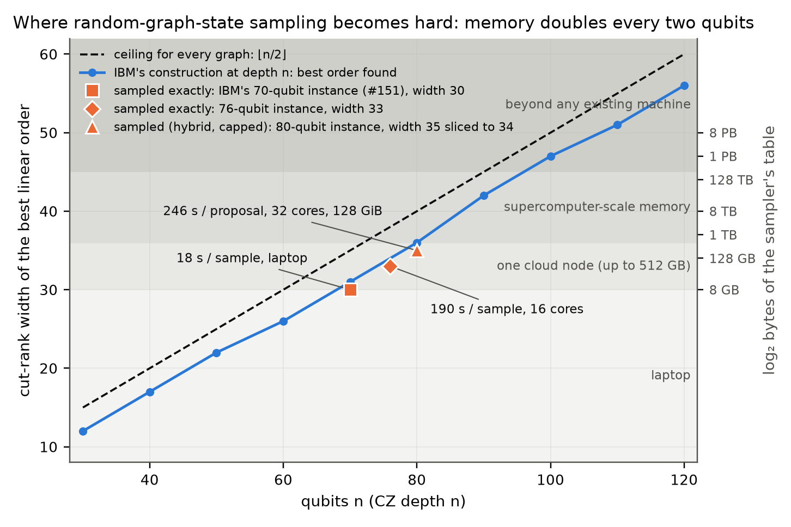

# Exact sampling of IBM's 70-qubit graph-state advantage experiment

**A laptop draws exact samples from the ideal output distribution of the 70-qubit, depth-70 random-graph-state
circuit that IBM and the University of Chicago ran as a quantum-advantage candidate (Quantum Advantage Tracker
#151), in about 17 s per sample. The same code scores IBM's 1,726 published hardware shots exactly, at full
depth, and samples a 76-qubit instance of the construction on one cloud node.**

Technical note: [`paper/exact_graphstate_sampling.pdf`](paper/exact_graphstate_sampling.pdf) (Markdown source alongside).

| | Result | Artifact |
|---|---|---|
| Exact samples of IBM's instance | **1,012 samples, 13.0 s each** on 16 cores (34 GB); **~17 s each on a laptop** (8.6 GB table) | `results/samples_nq70.txt`, `results/laptop_samples_w30.txt` |
| Independent engine, different algorithm | 6 samples reproduced to 1e-6 in log₂ Pr; 10-bit-flip control moves by 3.37 | `results/xcheck70_independent.txt`, `results/xcheck70d.txt` |
| IBM's hardware shots scored exactly | **linear XEB 0.466 ± 0.031**; controls at zero; every shot agrees with the independent code of #260 to 9.4e-6 | `results/ibmxeb/analysis.txt` |
| Fidelity of IBM's run, from exact probabilities | 0.457 ± 0.037 (XEB) and 0.48 [0.43, 0.54] (mixture MLE), against IBM's DFE 0.37 (≥ 0.092) | `results/ibmxeb/analysis.txt` |
| 76-qubit, depth-76 instance | **19 exact samples, 190 s each**, 67 GB, two reproduced to 1e-7 by the independent engine | `results/nq76/analysis.txt` |
| Conditionals checked without a dynamic program | stabilizer-group formula matches the sampler to 3.3e-8 on all 1,726 shots | `results/chain/stabprefix_ibm_fwd.txt` |
| Ceiling for every graph | width ≤ ⌊n/2⌋, so 2^{n/2} entries suffice for any graph state in any product basis: 275 GB at 70 qubits, 281 TB at 90; random graphs G(70, ½) reach 32, brickwork 31 | note §5, `results/ceiling_tightness.jsonl` |
| Where the signal is | no stabilizer of weight ≤ 11, so every marginal on ≤ 11 qubits is exactly uniform; IBM's shots show no 1-, 2-, 3- or 4-bit bias (χ² p = 0.78, 0.36, 0.28, 0.95) | `results/minweight.txt`, `results/hw_marginals.txt` |



## How it works

The circuit is a Clifford body followed by one layer of single-qubit rotations. The Clifford state is a
graph state |G_A⟩ up to local Cliffords, so every amplitude is a complex-weighted Ising sum on the graph:

    ⟨b|ψ⟩ = 2^{-n/2} Σ_x Π_j M_j[b_j, x_j] (−1)^{x^T A x}   (upper triangle)

Summing over x one vertex at a time, the processed vertices P act on the rest only through the GF(2) vector
A[F,P]·x_P, which takes 2^{r} values, r = cut rank of (P, F). The dynamic program therefore holds 2^{r}
complex numbers, not the 2^{2r} of a generic matrix product state. The best order found for IBM's instance
has r ≤ 30.

**The identity that makes exact sampling cheap.** After the first t qubits are measured, the unmeasured
qubits are in Σ_c P_t[c] Z^{v(c)}|G_F⟩, and the states Z^v|G_F⟩ are orthonormal. So

    Pr(b₁…b_t) = 2^{-t} Σ_c |P_t[c]|²

and one exact Born sample costs two passes of the dynamic program per qubit, with no right environment, no
rejection and no truncation. An in-place variant (`gsamp2.cpp`) keeps a single table of 2^{width} complex64
entries, which is what puts the 70-qubit instance on a laptop.

Since the cut rank of any prefix is at most min(|P|, n − |P|) ≤ ⌊n/2⌋, the same program samples *any*
n-qubit graph state in *any* product basis with 2^{⌊n/2⌋} entries. That ceiling is 275 GB at n = 70 and
281 TB at n = 90; IBM's construction sits within 3–4 of it.

## Reproduce

```
python test_tableau.py && python test_graphform.py && python test_plan.py && python test_amp.py   # exact vs statevector
python test_sampler.py && python test_inplace.py && python test_stabprefix.py                     # samplers and the stabilizer formula
g++ -O3 -march=native -fopenmp -o gsamp2 gsamp2.cpp                                               # in-place sampler (widths to 40)
./gsamp2 cloud_ibmxeb/nq70_inplace_plan.txt sample 3 2000000      # 3 exact samples of IBM's instance, 8.6 GB, ~17 s each on 16 threads
./gsamp2 cloud_ibmxeb/nq70_inplace_plan.txt prob strings.txt      # exact log2 Pr of given bitstrings (IBM's shots: cloud_ibmxeb/)
./gsamp2 cloud_ibmxeb/nq70_inplace_plan.txt chain strings.txt     # same, plus every conditional Pr(b_k | b_1..b_{k-1})
g++ -O3 -march=native -fopenmp -DDP_FLOAT -o dp dp.cpp      # independent sliced amplitude engine (xcheck_make.py builds its jobs)
python ibm_xeb_analyze.py results/ibmxeb/ibm_out.txt results/ibmxeb/uniform_out.txt results/ibmxeb/reversed_out.txt
python ibm_fidelity_mle.py results/ibmxeb/ibm_out.txt results/samples_nq70.txt
python report_run.py results/nq76/samples_nq76.txt 76 results/nq76/xcheck_out.txt results/nq76/xcheck_make_run6.txt
```

Inputs for every cloud run (plans, orders, bitstrings, `run.sh`) are in `cloud*/`; every run first
reproduces known probabilities as a gate, and `results/*/inputs.sha256` ties the outputs to these files.

## Verification: what is proven by running it

Each test has a negative control that is caught.

| Test | What it checks | Result |
|---|---|---|
| `test_tableau.py` | stabilizer tableau vs statevector | 200 circuits, 2.6e-16 |
| `test_graphform.py` | local-Clifford graph form | 150 circuits, overlap 1 − 2e-15 |
| `test_plan.py` | DP vs brute force | 120 cases, 3e-15 |
| `test_amp.py` | Born probabilities, end to end vs statevector | 60 circuits, 1e-15 |
| `test_sampler.py` | reference sampler: distribution implied by the chain, every string | 2e-15 |
| `test_engine.py` | C++ amplitude engine with slicing | 1e-14 (complex64 build agrees to 2e-7) |
| `test_gsamp.py` | C++ sampler, exact probabilities; 20,000 samples | 6e-9; TV 0.0570 = ideal sampler at that size |
| `test_inplace.py` | in-place single-table layout (Python reference), every string, 30 circuits | 1.4e-15; tau-swap control 0.152 |
| `test_gsamp2.py` | in-place C++ sampler: prob mode every string; 20,000 samples | 5.8e-9; TV 0.0570 = ideal |
| `test_chain.py`, `test_chain_gsamp.py` | one-pass `chain` mode: conditionals vs reference, log₂ Pr vs prob mode | 1e-7, 2e-6; swapped-M control 0.58 |
| `test_baseof.cpp` | base-address tables for widths to 40 | 10,000 cases; 4-table control fails 45/50 |
| `check_uniform_prefix.py` | engine-independent: first 30 step-bits of the 1,012 samples uniform (bit/pair/triple parities) | at chance; copy-bit control z = 31.8 |
| `test_stabprefix.py` | prefix marginals from the stabilizer group alone vs statevector, 162 prefixes | 6.4e-15; flipped-sign control 0.577 |
| `stabprefix.py` on the real instance | stabilizer-only conditionals vs chain mode, steps 1–42, all 1,726 IBM shots | 3.3e-8 (deviations from ½ up to 8e-5) |
| `xcheck55.py`, `xcheck70*.py` | 55- and 70-qubit real data: sampler Pr vs `dp.cpp` amplitude | 4e-7; 1e-6 on 6 samples, control 3.37 |
| cross-order (`results/chain/analysis_crossorder.txt`) | width-30 order, its reverse, width-31 order: same log₂ Pr for 2,738 strings | 1.4e-5 at worst |
| `minweight.py`, `minweight.cpp` | minimum stabilizer weight of the graph state (packed arithmetic checked against dense on 50 random v) | no weight ≤ 11 (exhaustive to 11 chosen vertices); weight 15 found |
| `hw_marginals.py` | 1-, 2-, 3-, 4-bit parities of IBM's shots and our samples vs the exactly uniform ideal (χ²) | shots p = 0.78/0.36/0.28/0.95; samples 0.010/0.76/0.97/0.12; biased-bit control p < 1e-4 |
| `rng_check.py`, `rngbits.cpp` | samples' first 22 bits = sign bits of std::mt19937_64(10⁶ + i) | 1012/1012; seed+1 control 0/1012 |
| `ceiling_tightness.py` | best width for G(n,½), G(n,0.3), brickwork vs ⌊n/2⌋ | n = 70: 32, 31–32, 31 vs 35 |

Full-instance runs (all on AWS r7a.4xlarge, 16 cores, AMD EPYC 9R14, 123 GB):

- **Sampling, 2026-10-29:** width-31 order, 1,012 exact samples in 13,202 s (`results/run.log`,
  `results/time_nq70.txt`), peak RSS 33.6 GB; inputs hash-identical to this repository (`results/inputs.sha256`);
  instance QASM SHA-256 `e0189bdd2e67d1456cb92f5c750b880cbee935220e539c04934906a94535ea5f`. The run first
  reproduced three 55-qubit samples bit for bit (`results/check55_result.txt`).
- **IBM's shots, 2026-10-31:** 1,726 strings at 6.9 s each, 16.8 GB (`results/ibmxeb/`). XEB 0.466 ± 0.031; 64
  uniform strings +0.16 ± 0.12; 64 bit-reversed shots −0.15 ± 0.10; per-shot agreement with #260's FP64 code
  9.4e-6 at worst, median 2.8e-7.
- **Chain mode, 2026-10-31:** every conditional of every shot and sample along the width-30 order and its
  reverse (`results/chain/`): the information in a string sits in its last ~8 conditionals (100% of the variance
  of log₂ Pr); per-step hardware/ideal ratios at the 8 informative qubits are 0.43–0.54.
- **76 qubits, 2026-10-31:** seed-1076 instance of the construction, width 33, 19 exact samples in 3,604 s, 67 GB
  (`results/nq76/`); the independent engine, gated on the two known 70-qubit values, reproduces two samples to 1e-7.

Self-consistency, not an independent check: the linear XEB of our own samples is 1.020 ± 0.047
(2⁷⁰ Σp² ≈ 2.02, Porter–Thomas would give 2); for the 76-qubit samples 0.83 ± 0.22.

## Relation to prior work

Rank-width simulation of graph-state measurements is known (Van den Nest, Dür, Vidal, Briegel, PRA 75, 012337
(2007); Kuyanov & Kissinger, arXiv:2603.06764; Renaud's `dcs-rankwidth`, tracker #249), and tracker #260
(2026-10-30) applies it to this instance with capped rejection sampling on two H200 GPUs, which is not an exact
Born sampler. New here: exact Born sampling through the prefix-marginal identity, the in-place single-table
layout and the laptop run, the exact full-depth scoring of IBM's hardware shots with controls and fidelity
estimators, the stabilizer-only check of the sampler's conditionals, the measured 76-qubit point and the
⌊n/2⌋ ceiling. The claim is about this family of experiments, not a new complexity result. The doped sibling
instance (468 T gates) is outside the reach of this method.

## Author

Chaitanya Talapalli, independent researcher. ORCID [0009-0000-8811-3349](https://orcid.org/0009-0000-8811-3349), chayt128@gmail.com.

## License

Apache-2.0 (see `LICENSE`).

## Cite

```
@misc{talapalli2026graphstate,
  title  = {Exact classical sampling of IBM's 70-qubit graph-state advantage experiment, and where the construction becomes hard},
  author = {Talapalli, Chaitanya},
  year   = {2026},
  note   = {ORCID 0009-0000-8811-3349; code and data at https://github.com/chayworks/exact-graphstate-sampling}
}
```
