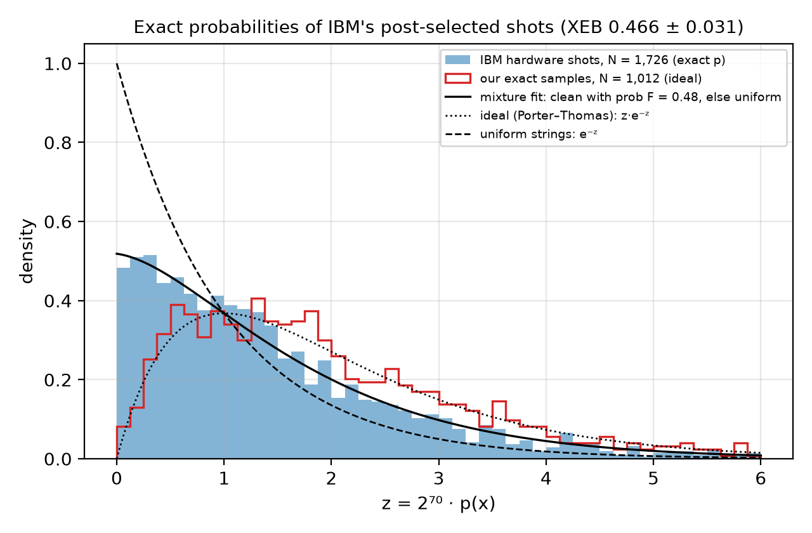
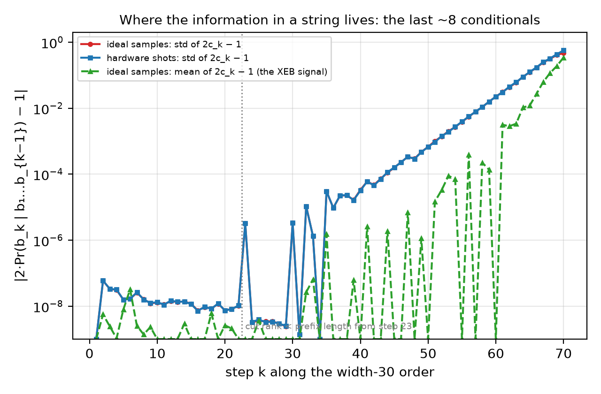
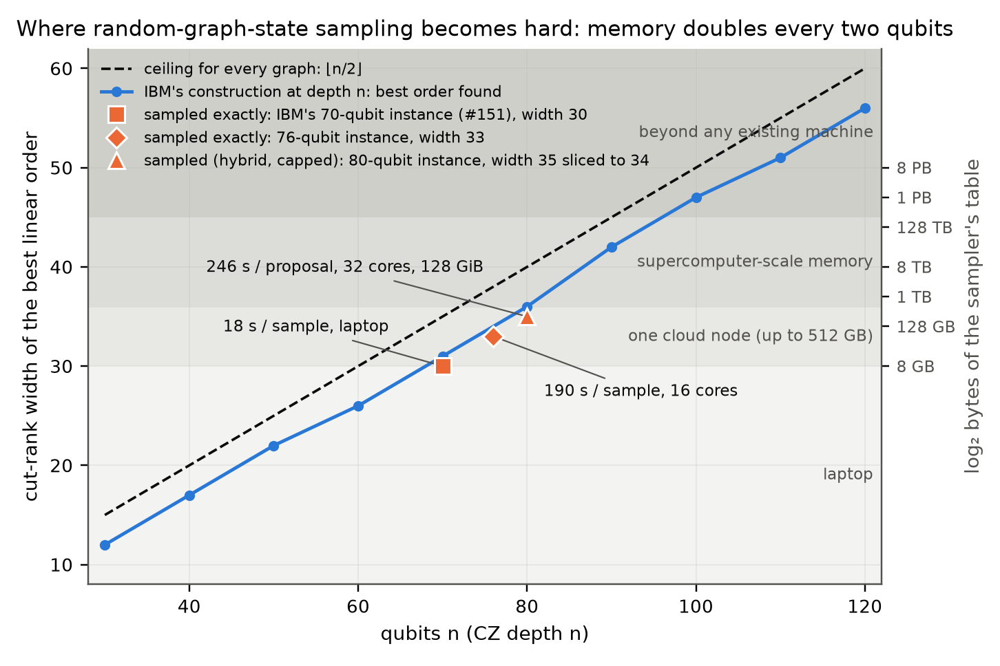

# Exact classical sampling of IBM's 70-qubit graph-state advantage experiment, and where the construction becomes hard

**Chaitanya Talapalli** — independent researcher — ORCID 0009-0000-8811-3349 — chayt128@gmail.com

Code, samples and raw outputs: https://github.com/chayworks/exact-graphstate-sampling (Apache-2.0).

*Technical note, draft of 31 October 2026. Every number in this note is read from a committed artifact listed in
the appendix, and every verification step has a negative control that fails as intended.*

## Abstract

In 2026 IBM and the University of Chicago posted a 70-qubit, depth-70 random-graph-state sampling experiment as
a candidate for verifiable quantum advantage (Quantum Advantage Tracker #151), with a measured state fidelity of
0.37 and extrapolated classical costs of 10²⁵ s (matrix product states) and 10⁷ s per sample (extended
stabilizer simulation). We show that the instance is sampled **exactly from the ideal Born distribution** by a
cut-rank dynamic program: **13.0 s per sample on one 16-core CPU node** (1,012 samples, 34 GB), and
**17 s per sample on a laptop** with an 8.6 GB table. No rejection, no truncation, no GPU.

Three further results follow from having the exact probabilities in hand.

1. **IBM's own hardware shots, scored exactly.** The full-depth linear cross-entropy benchmark, which the
   instance README says "can only be extrapolated", is computed for every one of the 1,726 published shots:
   **XEB = 0.466 ± 0.031**, controls at zero, and every per-shot probability agrees with an independently
   written program (tracker #260) to 10⁻⁵. Two fidelity estimators built on the exact probabilities give
   0.46 ± 0.04 and 0.48 [0.43, 0.54], above IBM's direct-fidelity estimate of 0.37 (95% lower bound 0.092) and
   much narrower.
2. **The frontier, measured rather than projected.** The width that governs the attack grows as 0.49·n − 2.9
   for this construction at depth n, so memory doubles every two qubits. We sampled a 76-qubit, depth-76
   instance exactly on the same 16-core node class (19 samples, 190 s each, 67 GB), with two samples reproduced
   to 10⁻⁷ by an independent engine. An 80-qubit instance is prepared (275 GB).
3. **A ceiling that holds for every graph.** Because a cut rank never exceeds min(|P|, n − |P|), *any*
   n-qubit graph state measured in *any* product basis is exactly samplable with 2^{⌊n/2⌋} table entries:
   275 GB at 70 qubits, 2.2 TB at 76, 281 TB at 90, 9 PB at 100. No graph-state sampling experiment with
   product measurements can escape a single large-memory node below about 76 qubits, or a supercomputer
   below about 90, whatever graph is chosen. The random brickwork construction already sits within 3–4 of
   this ceiling, so the only lever left to the experimenters is the qubit count. Random dense graphs reach the
   same widths as the brickwork at the same search budget (within one), so for this method the construction
   is already as hard as a random graph.

Two further facts follow from the stabilizer structure. The output distribution of the instance is **exactly
uniform on every set of at most 11 qubits** (no stabilizer of the graph state has weight below 12; one of
weight 15 is known), so no statistic on fewer than 12 qubits can see the signal, and verification of such an
experiment is global by nature. Conversely any low-order bias in the hardware shots is pure noise, detectable
without simulation: all 70 single-bit, 2,415 pair, 54,740 triple and 916,895 quadruple parities of IBM's
post-selected shots are at chance (χ² p = 0.78, 0.36, 0.28, 0.95), so whatever brings the fidelity to 0.46
leaves no trace below weight 5.

The method is two standard ingredients joined by one identity: the rank-width simulability of graph-state
measurements (Van den Nest et al. 2007) and perfect sampling in the style of Ferris and Vidal (2012), joined
by the observation that the post-measurement states Z^v|G⟩ are orthonormal, so every prefix marginal is a
plain sum of squares, Pr(b₁…b_t) = 2^{-t} Σ|P_t|². We verify the sampler against dense statevectors on
small instances, against an independent amplitude algorithm on the full instance, against a closed-form
stabilizer-group formula for its per-step conditionals (agreement 3·10⁻⁸ on all 1,726 shots), and across
three different dynamic-program paths.

## Results at a glance

| | Result | Artifact |
|---|---|---|
| Exact samples of IBM's 70-qubit instance | **1,012 samples, 13.0 s each**, 16 cores, peak 33.6 GB | `results/samples_nq70.txt`, `time_nq70.txt` |
| Same instance on a laptop | **3 samples, ~17 s each**, one 8.6 GB table | `results/laptop_samples_w30.txt` |
| Independent engine (different algorithm) | 6 samples reproduced to 10⁻⁶ in log₂ Pr; 10-bit-flip control moves by 3.37 | `results/xcheck70_independent.txt`, `xcheck70d.txt` |
| IBM's 1,726 hardware shots scored exactly | **linear XEB 0.466 ± 0.031**; uniform control 0.16 ± 0.12; bit-reversed control −0.15 ± 0.10 | `results/ibmxeb/analysis.txt` |
| Agreement with the independent code of #260 | 1,726 of 1,726 shots within 9.4·10⁻⁶ in log₂ Pr (median 2.8·10⁻⁷) | `results/ibmxeb/analysis.txt` |
| Fidelity of IBM's run from exact probabilities | 0.457 ± 0.037 (XEB) and 0.48 [0.43, 0.54] (mixture MLE); IBM's DFE 0.37, ≥ 0.092 | `results/ibmxeb/analysis.txt` |
| 76-qubit, depth-76 instance sampled exactly | **19 samples, 190 s each**, 67 GB, two reproduced to 10⁻⁷ by the independent engine | `results/nq76/analysis.txt` |
| Fine-structure check without a dynamic program | stabilizer-group formula reproduces the sampler's conditionals to 3.3·10⁻⁸ on all shots | `results/chain/stabprefix_ibm_fwd.txt` |
| Ceiling for every graph | width ≤ ⌊n/2⌋: 275 GB at n = 70, 281 TB at n = 90; random graphs G(70, ½) reach width 32, brickwork 31 | Proposition in §5, `results/ceiling_tightness.jsonl` |
| Low-order marginals of the ideal distribution | exactly uniform on every set of ≤ 11 qubits (no stabilizer of weight ≤ 11; one of weight 15 known) | `results/minweight.txt`, `results/minweight_k11.txt` |
| Hardware shots, simulation-free test | 70 single-bit, 2,415 pair, 54,740 triple and 916,895 quadruple parities at chance (χ² p = 0.78, 0.36, 0.28, 0.95) | `results/hw_marginals.txt` |

## 1. The task

Circuit `nq70_depth70_checks27_basis_fstate`, Quantum Advantage Tracker issue #151:
1. Hadamards on 70 qubits in a line.
2. Brickwork of nearest-neighbour CZ gates to CZ depth 70, with a random √X or S√X on every qubit between
   layers.
3. On every qubit, T†·H·Rz(θ)·H with θ = arccos(1/√3), a rotation into the "face-state" basis that maximises
   stabilizer extent.
4. Measurement in Z.

The hardware run (IBM Boston, Heron R3, with 27 ancillas for spacetime Pauli checks) reports a post-selected
fidelity of 0.37 from direct fidelity estimation of the underlying graph state, with a 95% lower bound of
0.092. 1,726 post-selected shots are published with the instance. The construction was chosen so that
stabilizer-extent methods cost 10⁷ s per sample and matrix-product-state methods 10²⁵ s, according to the
instance README.

## 2. Method

**Graph form.** The Clifford part maps to a stabilizer tableau, and then, by Gaussian elimination and
local Cliffords, to |S⟩ = ⊗U_j† |G_A⟩. Then

  ⟨b|ψ⟩ = 2^{-n/2} Σ_x Π_j M_j[b_j, x_j] (−1)^{Σ_{i<j} A_ij x_i x_j},  where M_j = W_j U_j†.

**Cut-rank dynamic program.** Fix a vertex order. After the prefix P is processed, the future depends
only on s = A[F,P]·x_P ∈ GF(2)^{|F|}. That vector lives in a space of dimension r = rank A[F,P], so the
prefix is a table P[c] of 2^r complex numbers in a chosen basis of that space. Each step is a surjective
GF(2)-linear map (c, x_v) ↦ c′. We evaluate it in gather form: a `pdep` scatter plus a kernel of
dimension at most 2. A generic matrix product state of the same cut needs bond dimension 2^r and therefore
cost polynomial in 2^r; here the cost is linear in 2^r.

**Exact sampling.** With prefix P measured with outcomes b_P, the post-measurement state is

  2^{-|P|/2} Σ_c P[c] Z^{B c} |G_F⟩.

For v ≠ 0, Z^v has no X part, so it anticommutes with some graph stabilizer and ⟨G|Z^v|G⟩ = 0. The
states {Z^v|G_F⟩} are therefore orthonormal, and Pr(b_P) = 2^{-|P|} Σ_c |P[c]|². Measuring qubit by qubit
in the DP order:
1. compute both candidate extensions' norms (one read-only pass);
2. draw the outcome;
3. store the chosen extension (a second pass).

This is the graph-state analogue of perfect MPS sampling (Ferris & Vidal 2012). The output is the exact
Born distribution, up to floating-point error. Unlike rejection sampling, the cost does not depend on the
shape of the output distribution, and unlike capped rejection sampling (#260) the output law is the Born law.

**In-place layout.** A second program keeps a single table and updates it in place, so the memory is
2^{width} complex64 entries rather than two tables of 2^{width+1}: 8.6 GB for the width-30 order of this
instance, which is why a laptop can run it.

**Cost for this instance.** A greedy-plus-local-search order (`order2.py`) reaches maximum cut rank 30, the
value #260 also reports; the natural order gives 32. The production sampling run used an earlier width-31
order and cost 4·Σ_k 2^{r_k} = 6.0·10¹⁰ table updates per sample with two complex64 tables of 2³¹ entries;
the later runs (laptop, hardware-shot scoring, chain mode) use the width-30 order.

## 3. Results

### 3.1 Sampling IBM's instance

1,012 samples in 13,202 s on an AWS r7a.4xlarge (16 cores, AMD EPYC 9R14), peak RSS 33.6 GB, about $4.50
of on-demand time.
- All samples are distinct.
- Linear XEB against their own exact probabilities is 1.020 ± 0.047, i.e. 2⁷⁰ Σ p² ≈ 2.02,
  consistent with Porter–Thomas-like output.

**Laptop.** With the in-place program, the arena is a single complex64 table of 2^30 entries (8.6 GB) for a
width-30 order. On a laptop (AMD Ryzen 9 9955HX, 16 threads, container memory capped at 10 GB), 3 exact
samples took 55 s including allocation, i.e. **about 17 s per exact sample**
(`results/laptop_samples_w30.txt`). The in-place sampler was validated on every bitstring of small circuits.
On the full instance it reproduces the cloud samples' log₂ Pr to 3·10⁻⁷, and the independent amplitude
engine confirms the first laptop sample: −68.5019327 against −68.5019326 reported
(`results/xcheck70e_laptop.txt`).

### 3.2 IBM's hardware shots, scored exactly

The sampler's probability mode evaluates the exact Born probability of a given bitstring through the same
code path as sampling. We scored all 1,726 hardware shots published with #151 on an r7a.4xlarge: 6.9 s per
shot, 3 h 19 min in all, 16.8 GB peak (`results/ibmxeb/`). The run first reproduced two earlier cloud
samples' log₂ Pr to 5·10⁻⁷ as a gate.

| strings | N | linear XEB |
|---|---|---|
| IBM hardware shots | 1,726 | **+0.466 ± 0.031** (bootstrap 95% [+0.41, +0.53]) |
| uniform random strings (control) | 64 | +0.16 ± 0.12 |
| IBM shots with the bit order reversed (control) | 64 | −0.15 ± 0.10 |

Our log₂ Pr agrees with #260's independently written FP64 code on every one of the 1,726 strings, to
9.4·10⁻⁶ at worst (median 2.8·10⁻⁷), and the XEB of +0.4660 is the same to four digits. Two programs
written independently assign the same probability to each of IBM's shots.

Normalising by the ideal value 2⁷⁰Σp² − 1 = 1.020 ± 0.047, measured on our own exact samples, gives a
fidelity estimate F_XEB = 0.457 ± 0.037. A second estimator uses the whole distribution of z = 2⁷⁰·p(x)
over the shots rather than its mean. If each shot is drawn from the ideal distribution with probability F
and uniformly otherwise, the density of z over shots is (Fz + 1 − F)e^{−z}, and the maximum-likelihood
fit gives F_MLE = 0.48 [0.43, 0.54] (profile likelihood, 95%). The mixture fits the observed shot
distribution (Kolmogorov–Smirnov distance 0.018, 5% threshold 0.033; `ibm_fidelity_mle.py`, which recovers
F = 0, 0.4 and 1 on synthetic data).

*Figure 2. Distribution of z = 2⁷⁰·p(x) over IBM's 1,726 post-selected shots (exact p), our 1,012 exact samples, and the fitted clean/uniform mixture (`paper/make_figures.py`).*

The instance README (tracker repository, `random_graph_sampling/README.md`) states that "XEB requires
classical simulations for the outcome probabilities, hence can only be extrapolated for the full-depth
circuit". Here it is computed exactly for every published shot. The shots are post-selected by spacetime
Pauli checks on 27 ancillas, and the README reports a post-selected state fidelity of 0.37 by direct
fidelity estimation with 80 random stabilizers, "bounded above 0.092 with 95% confidence". Our two
estimates, 0.457 ± 0.037 and 0.48 [0.43, 0.54], are consistent with that bound and higher than the point
estimate, with a much narrower interval. The quantities differ (the full circuit including the
non-Clifford measurement layer, versus the stabilizers of the graph state; the README argues they agree to
first order under Pauli twirling), and linear XEB is known to over-estimate fidelity under
non-depolarising noise, so we report the gap without interpreting it. It is, in our view, the most useful
thing in this note for the experimenters: an exact, per-shot benchmark of their device at full depth.

### 3.3 A 76-qubit instance, sampled

To test the frontier with a measurement rather than a projection, we generated a 76-qubit, CZ-depth-76
instance of the same construction (`frontier_instance.py`, seed 1076, 1,465 edges), found an order of width
33 (natural order 38), and ran the in-place sampler on the same 16-core node class (r7a.4xlarge, 128 GiB):
**19 exact samples in 3,604 s, 190 s per sample, 67 GB peak** (`results/nq76/`). The node first reproduced
the two 70-qubit reference probabilities as a gate. All 19 samples are distinct; their self-consistency XEB
is 0.83 ± 0.22. The independent sliced amplitude engine, built with complex64 tables and itself gated on the
two known 70-qubit values (−69.5085289 and −68.8761655 against −69.5085302 and −68.8761651), recomputes
the first two samples' log₂ Pr as −74.1389442 and −75.3402128 against the sampler's −74.1389441 and
−75.3402127 (`results/nq76/analysis.txt`). An 80-qubit instance (seed 1080) has an order of width 35, a
275 GB table; its inputs are prepared and the run waits on cloud capacity.

## 4. Verification

1. **Small instances.** On circuits of the same form with up to 9 qubits, the distribution implied by
   the sampler matches the statevector on every bitstring to 2·10⁻¹⁵. The C++ sampler's 20,000-shot
   histogram has the same total-variation distance from the exact distribution as an ideal sampler's.
   Every test has a negative control that fails as intended.
2. **Full instance.** A sliced amplitude engine recomputes log₂ Pr of sampled bitstrings; it is a
   different algorithm from the sampler.

   | sample | sampler log₂ Pr | independent engine log₂ Pr |
   |---|---|---|
   | 1 | −69.5085302 | −69.5085294 |
   | 2 | −68.8761651 | −68.8761651 |
   | 3 | −68.3318209 | −68.3318207 |
   | 4 | −69.0978566 | −69.0978571 |
   | 5 | −70.2946875 | −70.2946876 |

   Control: sample 1 with 10 bits flipped gives −72.8808316. That is 3.37 lower in log₂ (10× less likely),
   against agreement within 1e-6 on the real samples.
3. **Reproducibility.** The production run first reproduced, bit for bit, three samples generated on a
   different machine, compiler and thread count.
4. **Engine-independent check.** While the cut rank of the measured prefix equals its length, the reduced
   state is maximally mixed, so the prefix marginal is exactly uniform; for the production order that holds
   for the first 30 steps. Over the 1,012 samples the first 30 step-bits show pair parities (435 tests) and
   triple parities (4,060 tests) at chance (4.8% and 4.4% beyond 2σ, 4.6% expected; largest |z| 3.2 and
   3.8). Of the 30 single-bit means, 4 fall beyond 2σ (p ≈ 0.05), the largest at 2.4σ. A control in which
   one bit is replaced by a copy of another fails the test (`check_uniform_prefix.py`,
   `results/uniform_prefix_check.txt`). This uses only the rank profile and the sample file.
5. **Stabilizer-only conditionals.** Once the cut rank falls below the prefix length, the prefix marginal has
   a closed form from the stabilizer group alone: Pr(b_F) = 2^{-t} Σ_S sign(S) Π_{j∈supp S} (−1)^{b_j} n_j[S_j],
   summed over the 2^{t−rank} stabilizers supported on F, with n_j the Bloch vector of the measured
   operator. We enumerate that sum exactly while the deficit is at most 16 (steps 1–42 of the width-30
   order) and compare the resulting conditionals Pr(b_k | b_1…b_{k−1}) with the sampler's chain output for
   all 1,726 hardware shots: the two agree to 3.3·10⁻⁸ (the print resolution), while the conditionals
   themselves depart from ½ by up to 8·10⁻⁵ at those steps (`stabprefix.py`,
   `results/chain/stabprefix_ibm_fwd.txt`). On small circuits the same formula reproduces the
   statevector marginals to 6·10⁻¹⁵ on 162 prefixes, and a flipped generator sign fails it. This is a
   check of the dynamic program's fine structure by a method that never builds the DP table.

   The same formula explains where the information in a string lives: a stabilizer of weight w contributes
   at most max|n|^w, so the conditionals stay within 10⁻⁴ of ½ until the prefix supports many low-weight
   stabilizers, which in this order happens only in the last ~10 steps; the per-step spread of the chain
   conditionals grows by about 1.4× per step from 10⁻⁴ at step 50 to 0.56 at step 70, and the last 8 steps
   carry 2.91 of the 2.93 variance of log₂ Pr across the hardware shots
   (`results/chain/ibm_fwd_chain.txt`). For our 1,012 exact samples the picture is the same: the
   spread of the conditionals first exceeds 10⁻³ at step 51 (52 in the reversed order), and the last 4 and
   8 steps account for 90% and 100% of the variance of log₂ Pr (`results/chain/analysis_profile.txt`).
6. **Three dynamic-program paths agree.** Scoring every string along the width-30 order, along its reverse
   (the same width, a different table layout and step sequence), and, for our samples, along the width-31
   production order gives the same log₂ Pr: the forward and reversed orders agree to 1.4·10⁻⁵ at worst
   (median 4·10⁻⁷) on the 1,726 hardware shots and to 3.5·10⁻⁶ on the 1,012 samples, and the width-31 run
   agrees with the width-30 order to 4.3·10⁻⁶ (`results/chain/analysis_crossorder.txt`). The
   stabilizer-only check of item 5 also holds along the reversed order and on the ideal samples (3.3·10⁻⁸,
   `results/chain/stabprefix_rev_ideal.txt`).
7. **Simulation-free test, and the sampler's random stream.** By §6 every marginal of the ideal distribution
   on at most 11 qubits is exactly uniform, so all single-bit means, pair parities and triple parities are
   exactly zero (for ±1 bits), and their sums of squared z-scores are χ² with as many degrees of freedom as
   tests. Our 1,012 samples: pairs p = 0.76, triples p = 0.97, quadruples p = 0.12, single bits χ² = 100 on 70
   (p = 0.010); the
   test is calibrated on truly uniform bits (`hw_marginals.py`, `results/hw_marginals.txt`), and a control with
   one bit biased by 15% fails it (p < 10⁻⁴). We examined the single-bit excess. For the first 22 steps of the
   production order the conditional is exactly ½, so the sampled bit must equal (U < ½) for the sampler's
   uniform draw U; reproducing the stream (std::mt19937_64 seeded with 10⁶ + i, `rngbits.cpp`) gives exactly
   that bit in 1,012 of 1,012 samples, and in 0 of 1,012 with the seed shifted by one (`results/rng_check.txt`).
   The sampler is therefore deterministic given its stream, and the excess sits in steps 23–70 (χ² 70.9 on 48,
   p = 0.018), where the drawn bit depends on the conditional that items 2, 5 and 6 verify. A scan of 300
   blocks of 1,012 consecutive seeds shows no bias in the stream (mean χ² 70.3 ± 0.7 on 70). We record the
   single-bit p = 0.010 as a one-in-a-hundred fluctuation and flag it rather than explain it away.

*Figure 3. Spread of the exact per-step conditionals along the width-30 order for the hardware shots and the ideal samples, and the mean of 2c_k − 1 over ideal samples where it is resolved (the per-step XEB signal). The first 22 conditionals are exactly ½; the information sits in the last ~8 steps.*

**Per-step fidelity of the hardware shots.** Dividing the hardware mean of 2c_k − 1 by the ideal mean gives a
fidelity-like ratio for each informative step. Because the information sits in the last steps, only four
steps per order are informative (ideal mean above 0.05): in the forward order, qubits 9, 8, 13 and 50 give
0.45 ± 0.12, 0.54 ± 0.08, 0.52 ± 0.07 and 0.48 ± 0.04; in the reversed order, qubits 45, 68, 53 and 21 give
0.47 ± 0.10, 0.43 ± 0.07, 0.43 ± 0.06 and 0.53 ± 0.05. All eight are consistent with the global fidelity
estimates of 0.46–0.48 and none stands out, so the shots show no sign of a qubit that is much worse than
the rest among those eight. A per-qubit map of all 70 qubits would need an order ending in each group of
about four qubits, roughly 18 further width-30 passes; we did not run them.

## 5. Hardness frontier

We generated circuits with the #151 construction (linear chain, alternating CZ brickwork with random √X or
S√X layers, CZ depth n) for n = 30–120, with one instance per n, and ran the same order search
(`frontier.py`, output `results/frontier.jsonl`). At n = 70 the generated instance matches the real one:
1,192 vs 1,150 edges, natural-order width 33 vs 32, best width 31 vs 31 at the same search budget (a
longer search on the real instance reaches 30).

| n | best width found | memory (2 complex64 tables) | table updates per exact sample |
|---|---|---|---|
| 30 | 12 | < 1 MB | 2^16.7 |
| 50 | 22 | 67 MB | 2^26.4 |
| 60 | 26 | 1.1 GB | 2^30.8 |
| **70** | **31** | **34 GB** | **2^36.0** |
| **76 (sampled)** | **33** | **69 GB in-place** | **2^38.2** |
| 80 | 36 (35 found later) | 1.1 TB (275 GB in-place) | 2^41.2 |
| 90 | 42 | 70 TB | 2^46.3 |
| 100 | 47 | 2.3 PB | 2^51.4 |
| 110 | 51 | 36 PB | 2^55.9 |
| 120 | 56 | 1.2 EB | 2^61.2 |

*Figure 1. Best width found versus n for the construction, the ⌊n/2⌋ ceiling that holds for every graph, the two instances sampled exactly, and the memory of the in-place table. Shaded bands mark what a laptop, one cloud node, a supercomputer, and no existing machine can hold.*

The width fits 0.492·n − 2.9; at every n it is between n/2 − 4 and n/2 − 3. So memory doubles with
every two qubits. At depth n, this method moves from one server (n = 70) to one large-memory node
(n ≈ 80), to a leadership-class supercomputer (n ≈ 90), and past any existing machine (n ≳ 100).

**Proposition (a ceiling for every graph).** *Let |G⟩ be a graph state on n qubits and let each qubit be
measured in an arbitrary single-qubit basis. For every linear order of the qubits, the cut rank of every
prefix is at most ⌊n/2⌋. Consequently the sampler above draws an exact Born sample with at most 2^{⌊n/2⌋}
complex table entries and at most 4·n·2^{⌊n/2⌋} table updates, whatever the graph and whatever the
measurement bases.*

*Proof.* The cut rank of a prefix P is the GF(2) rank of the |F| × |P| adjacency block A[F,P], which is at
most min(|P|, |F|) = min(t, n − t) ≤ ⌊n/2⌋. The in-place sampler's table has 2^{r_k} entries at step k and
each step makes at most four passes over it. ∎

The proposition is elementary, but its consequence is not widely stated: at n = 70 the ceiling is 275 GB and
about 9.6·10¹² updates, roughly 4 hours per sample at our measured 6.4·10⁸ updates per second on 16
threads; at n = 76 it is 2.2 TB (the largest single cloud nodes); at n = 90 it is 281 TB (the aggregate
memory of a leadership machine); at n = 100 it is 9 PB. So no graph-state sampling experiment with product
measurements can escape a single large-memory node below about 76 qubits, or a supercomputer below about
90, no matter how the graph is chosen. The random brickwork construction already sits within 3–4 of this
ceiling (Figure 1), so better graphs cannot buy the experimenters more than a factor of about 10 in memory;
the only lever left is the qubit count.

**Is the ceiling tight?** Running the same order search (3,000 local-search steps, two instances per cell) on
Erdős–Rényi graphs G(n, ½) and G(n, 0.3) and on the brickwork construction gives
(`ceiling_tightness.py`, `results/ceiling_tightness.jsonl`):

| n | ceiling ⌊n/2⌋ | G(n, ½) | G(n, 0.3) | brickwork |
|---|---|---|---|---|
| 40 | 20 | 16, 16 | 16, 16 | 16, 17 |
| 50 | 25 | 21, 21 | 22, 21 | 22, 21 |
| 60 | 30 | 26, 26 | 26, 26 | 26, 26 |
| 70 | 35 | 32, 32 | 32, 31 | 31, 31 |

Random graphs of either density sit 3–4 below the ceiling and the brickwork within one of them, so for this
method the construction is already as hard as a random graph, and the ceiling is tight to within the
heuristic's few bits.

**Caveats.** The widths are upper bounds from heuristic orders; better orders or tree decompositions would
lower them. Slicing trades memory for time at a measured cost of about 1.5× per sliced vertex on this
instance, not 2×. The table has one instance per n. The ceiling bounds this family of methods, not all
classical methods, and says nothing about circuits that are not graph states followed by product
measurements: the doped sibling instance on the tracker, with 468 T gates spread through the circuit, is
outside its reach (its amplitudes were computed by tensor-network methods in arXiv:2608.13110).

## 6. Where the signal is: no marginal on fewer than 12 qubits carries any

In the graph frame every stabilizer is S_v = X^v Z^{Av} with support v ∪ Av, and by the formula of §4 item 5
the marginal of the output distribution on a qubit set F is Pr(b_F) = 2^{-|F|} Σ_{S supported on F} sign(S)
Π_j (−1)^{b_j} n_j[S_j]. The measured Bloch vectors have no zero component (all three components are ±1/√3
in the graph frame), so:

**Proposition.** *The marginal on F is exactly uniform if and only if no nontrivial stabilizer is supported
inside F. In particular every marginal on fewer than d_min qubits is exactly uniform, where d_min is the
minimum weight of a stabilizer of the graph state, and a stabilizer of weight w shifts a marginal by at most
3^{−w/2}.*

For IBM's instance, exhaustive enumeration of all v with at most 11 vertices (2.6·10¹² stabilizers, 14 minutes
on 16 threads, `minweight.cpp`) finds none of weight below 15; since weight(S_v) ≥ |v|, **no stabilizer has
weight ≤ 11**, and the lightest known has weight 15 (v = {0, 5, 27, 42, 48, 49, 52, 58, 61};
`results/minweight.txt`, `results/minweight_k11.txt`). So **12 ≤ d_min ≤ 15**: every marginal on at most 11
qubits is exactly uniform, and even the first non-uniform marginals deviate by at most about 3^{−7.5} ≈ 3·10⁻⁴
per stabilizer. This is the stabilizer-side statement of Figure 3: no test restricted to a few qubits, however
many shots, can tell the ideal output from coin flips; the signal lives in correlations of weight ≥ 12, and
verifying such an experiment is global by nature.

The same fact turns the hardware shots into a simulation-free diagnostic. Any deviation of a ≤ 11-qubit
marginal of the device from uniform is noise, measurable from the shots alone. For IBM's 1,726 post-selected
shots all 70 single-bit means (χ² 61 on 70, p = 0.78), 2,415 pair parities (p = 0.36, largest |z| 4.4),
54,740 triple parities (p = 0.28) and 916,895 quadruple parities (p = 0.95, largest |z| 5.6, which is p ≈ 0.02
after correcting for the number of tests) are at chance (`results/hw_marginals.txt`). The errors that bring the
fidelity to about 0.46 therefore leave no low-order trace at all: no biased qubit, no correlated pair, no
correlated triple or quadruple; after the Pauli checks the residual noise acts on the output like a global
depolarisation. This is consistent with the mixture
fit of §3.2 and is, we think, a useful fact for the experimenters.

## 7. What this does and does not show

It shows:
- the 70-qubit instance is sampled exactly, from the Born distribution, on a laptop, so it does not
  demonstrate a task beyond classical reach;
- the published hardware data can be benchmarked exactly at full depth, which the experiment's own README
  describes as impossible, and the resulting fidelity estimate is tighter than the one obtained on the device;
- the same construction stays within one node's reach to about 80 qubits (measured at 76), within a
  supercomputer's to about 90, and that no choice of graph changes this by more than a few qubits (random
  graphs measured within one of the brickwork);
- the output distribution is exactly uniform on every set of at most 11 qubits, and IBM's shots show no
  low-order bias at all.

It does not show:
- a new complexity-theoretic result; the rank-width reduction is from 2007 and the ceiling is elementary;
- priority on attacking this instance; #260 applied the same reduction with capped rejection sampling the
  day before our first run, and we cite it throughout;
- anything about the doped instance, or about graph-state experiments with entangled measurements.

**What we would suggest the experimenters run next.** At depth n with n ≥ 100, the ceiling alone puts any
graph beyond rank-width methods (9 PB), with no dependence on the particular graph; alternatively, doping
with a few hundred non-Clifford gates, as in the sibling instance, defeats this method outright. In either
case the exact scorer here can still compute full-depth XEB for any graph-state run up to about 80 qubits,
so an experiment at that scale can report an exact benchmark instead of an extrapolated one.

## 8. Related work

- Rank-width simulability of graph-state measurements: Van den Nest, Dür, Vidal, Briegel, PRA 75, 012337 (2007).
- Perfect sampling of matrix product states: Ferris & Vidal, PRB 85, 165146 (2012).
- ZX-calculus rank-width contraction: Kuyanov & Kissinger, arXiv:2603.06764.
- Exact amplitudes of IBM's doped circuits by T-injection and rank-width: Renaud, `dcs-rankwidth`; tracker #249.
- Capped rejection sampling for this instance on GPUs: tracker #260.
- Exact tensor-network amplitudes for the doped 70-qubit instance: Manabe, Gu, Pan, arXiv:2608.13110.
- The random-graph-state hardness argument behind the construction: arXiv:2412.07058.

## Appendix: artifacts

All paths are relative to the repository root.

- `results/samples_nq70.txt`, `run.log`, `time_nq70.txt`, `inputs.sha256`, `check55_result.txt`: the
  production sampling run and its reproduction check.
- `results/xcheck70_independent.txt`, `xcheck70d.txt`, `xcheck70e_laptop.txt`: independent
  recomputation of five cloud samples, the 10-bit control, and one laptop sample.
- `results/laptop_samples_w30.txt`: the laptop run (3 samples, timing).
- `results/ibmxeb/`: exact log₂ Pr of the 1,726 hardware shots and the controls, timing, gate,
  input hashes, and `analysis.txt` (XEB, comparison with #260, fidelity estimators).
- `results/chain/`: per-step conditionals of all shots and samples along two orders, the stabilizer-only
  comparison, the cross-order comparison and the information profile.
- `results/nq76/`: the 76-qubit samples, timing, gate, independent check and `analysis.txt`.
- `results/uniform_prefix_check.txt`: the engine-independent uniformity check.
- `results/minweight.txt`, `results/minweight_k11.txt`, `results/nq70_graph_adjacency.txt`: the stabilizer
  minimum-weight search and the graph it ran on.
- `results/hw_marginals.txt`, `results/rng_check.txt`, `results/rngbits_seeds_*.txt`: the low-order marginal
  test of the shots and samples, and the random-stream identity check.
- `results/ceiling_tightness.jsonl`: widths of random graphs and brickwork instances against the ceiling.
- `results/frontier.jsonl`: the frontier search output.
- `README.md`: the test table, the commands that reproduce each number, and the modes of the samplers.
