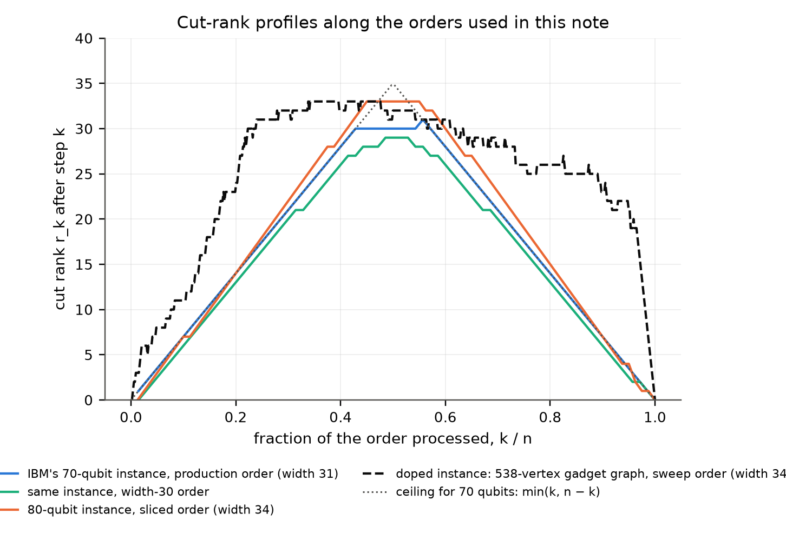
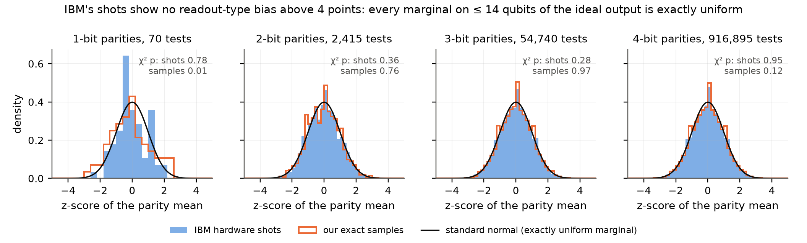
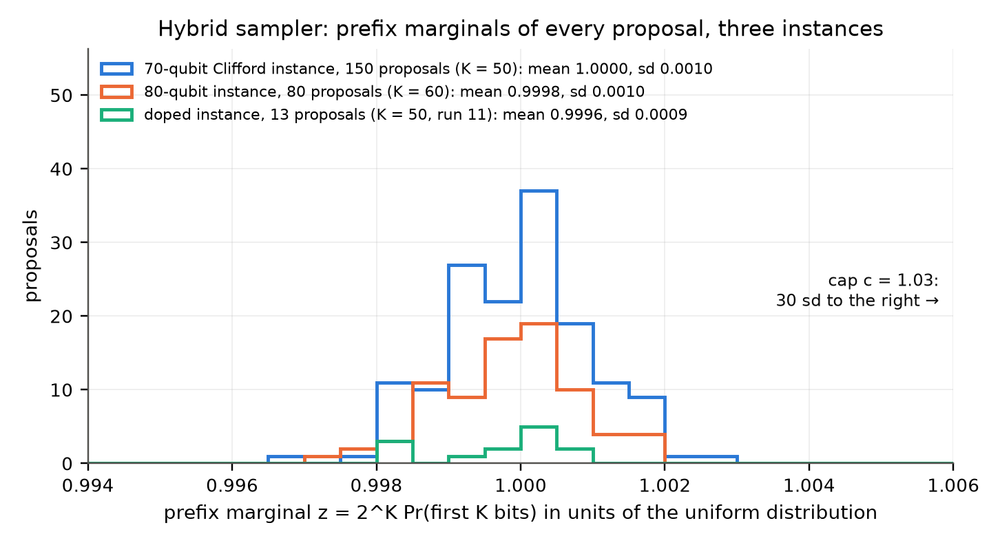

# Exact classical sampling of IBM's 70-qubit graph-state advantage experiment, and where the construction becomes hard

**Chaitanya Talapalli** — independent researcher — ORCID 0009-0000-8811-3349 — chayt128@gmail.com

Code, samples and raw outputs: https://github.com/chayworks/exact-graphstate-sampling (Apache-2.0).

*Technical note, draft of 2 November 2026, revised after an internal referee pass (`paper/reviews/`). Every number in
this note is read from a committed artifact listed in the appendix, including the outputs of the test scripts
(`results/tests/`), and every verification step has a negative control that fails as intended.*

## Abstract

IBM and the University of Chicago posted a 70-qubit, depth-70 random-graph-state sampling experiment as a candidate
for verifiable quantum advantage (Quantum Advantage Tracker #151), with extrapolated classical costs of 10²⁵ s
(matrix product states) and 10⁷ s per sample (extended stabilizer simulation). We sample the instance exactly from
its ideal Born distribution with a cut-rank dynamic program on the underlying graph state, at 13 s per sample on one
16-core CPU node and 11 s per sample on a laptop with an 8.6 GB table, and compute the exact probability of each of
the 1,726 published hardware shots: linear cross-entropy 0.466 ± 0.031, a quantity the instance's documentation said
could only be extrapolated. The width that governs the method grows as about n/2 − 4 for this construction, so memory
doubles every two qubits; we sample a 76-qubit instance exactly and an 80-qubit instance with a capped hybrid sampler
on one node, and note that any graph state measured in any product basis is samplable with 2^{⌊n/2⌋} table entries.
The graph state is a [[70, 0, 15]] code, so every marginal on at most 14 qubits is exactly uniform. Writing each T
gate of IBM's doped sibling instance as a projected ancilla brings it into the same framework at width 34: its exact
amplitudes, computed on one node, agree with a 256-GPU tensor-network computation shot by shot up to one common
factor of 1.8·10⁻⁴. Concurrent work (tracker #261) samples the same 70-qubit instance exactly on 8 GPUs with 32 times
the laptop's table.

## 1. Introduction

In 2026 IBM and the University of Chicago posted a 70-qubit, depth-70 random-graph-state sampling experiment as
a candidate for verifiable quantum advantage (Quantum Advantage Tracker #151), with a measured state fidelity of
0.37 and extrapolated classical costs of 10²⁵ s (matrix product states) and 10⁷ s per sample (extended
stabilizer simulation). We show that the instance is sampled **exactly from the ideal Born distribution** by a
cut-rank dynamic program: **13.0 s per sample on one 16-core CPU node** (1,012 samples, 34 GB), and
**11 s per sample on a laptop** with an 8.6 GB table (1,012 samples on 32 threads; an earlier 3-sample run on 16
threads took 18 s per sample). For this instance there is no rejection, no truncation and no GPU. Concurrently,
tracker entry #261 (Qiu, 2 November 2026) reports exact samples of the same instance on 8 H200 GPUs, 2.42 s per
sample per two-GPU job and 1,726 samples in 1,265 s of wall clock on four such jobs, by splitting the qubits into two
halves of 35 and drawing one half from a 2^{35} conditional table (256 GiB): that is the ceiling of item 3 below
with no order search, 32 times the laptop's table, and it scores IBM's shots at the same 0.466 ± 0.031. Our results
on the laptop, at 76 and 80 qubits, and on the doped instance (item 4) were not reported there, and its issue states
that the doped instances are outside its method's scope.

Four further results follow from having the exact probabilities in hand.

1. **IBM's own hardware shots, scored exactly.** The full-depth linear cross-entropy benchmark, which the
   instance README treats as out of reach for simulation (quoted in §3.2), is computed for every one of the 1,726
   published shots:
   **XEB = 0.466 ± 0.031**, controls consistent with zero, and every per-shot probability agrees with an independently
   written program (tracker #260) to 10⁻⁵. Two fidelity estimators built on the exact probabilities give
   0.46 ± 0.04 and 0.48 [0.43, 0.54], above IBM's direct-fidelity estimate of 0.37 (95% lower bound 0.092) and
   much narrower; the two quantities differ, and §3.2 says how.
2. **The frontier, measured rather than projected.** The width that governs the attack grows as 0.49·n − 2.9
   for this construction at depth n, so memory doubles every two qubits. We sampled a 76-qubit, depth-76
   instance exactly on the same 16-core node class (19 samples, 190 s each, 69 GB), with two samples reproduced
   to 10⁻⁷ by an independent engine. An 80-qubit, depth-80 instance (width 35, a 275 GB table) then ran on one
   256 GiB node by slicing one vertex with a translation of the dual table (§3.4), using the hybrid sampler of §7
   (60 bits proposed and accepted against their exact marginal, 20 drawn exactly): 79 samples at 246 s per
   proposal, 79 of 80 proposals accepted, every marginal within 0.3% of the uniform value against a cap of 3%.
   Its output is the Born law conditioned on the marginal staying under the cap; the excluded mass is small under
   a model but not proven, so we do not call these samples exact. Two were re-scored by a second slicing of the
   same engine to 5·10⁻⁷.
3. **A ceiling that holds for every graph.** Because a cut rank never exceeds min(|P|, n − |P|), *any*
   n-qubit graph state measured in *any* product basis is exactly samplable with 2^{⌊n/2⌋} table entries:
   275 GB at 70 qubits, 2.2 TB at 76, 8.8 TB at 80, 281 TB at 90, 9 PB at 100. So no graph-state sampling
   experiment with product measurements escapes a 2 TB node below 76 qubits, a 32 TB node (the largest sold
   today) below 84, or a 281 TB machine below 90, whatever graph is chosen. The random brickwork construction
   sits 3–5 below this ceiling at the search budgets we used (its fitted width stays on a 32 TB node to about
   90 qubits), so the choice of graph can buy the experimenters at most a factor of about 30 in memory; the
   qubit count is the main lever. Random dense graphs reach the same widths as the brickwork at the same search
   budget (within one), so for this method the construction is as hard as a random graph.
4. **IBM's doped flagship, in the same framework.** The sibling instance with 468 T gates, whose README calls it
   adversarial for stabilizer and tensor-network methods alike, becomes a 538-vertex graph state in a product basis
   once each T gate is written as a projected ancilla, with an order of width 34 (§7). One exact amplitude is then
   128 GiB of tables on one node (two slices of 2^{33} for the two-table engine), 1,165 s per amplitude. Seventeen of
   IBM's hardware shots agree with the 256-GPU tensor-network entry #242 to a common factor of 1.8·10⁻⁴ (16 of 17
   within 10⁻⁵ of it; shot 1 across seven of our computations to 1.4·10⁻⁶), #242's published amplitudes give the hardware fidelity 0.34 ± 0.03 three independent ways, above the
   README's 0.26 ± 0.02, and the first 13 hybrid samples of the instance were drawn on the same node (13 of 13
   accepted against the cap).

Two further facts follow from the stabilizer structure. The output distribution of the instance is **exactly
uniform on every set of at most 14 qubits**: the graph state is a [[70, 0, 15]] stabilizer code, equivalently a
14-uniform state, its distance 15 proven by exhaustive enumeration, so no statistic on fewer than 15 qubits can see
the signal, and verification of such an experiment is global by nature. The same fact limits what low-order
statistics of the hardware shots can show: a Pauli error anywhere in the circuit leaves a stabilizer state with the
same group up to signs, whose marginals below weight 15 are still exactly uniform, so only readout asymmetry and
non-Pauli channels can bias them. All 70 single-bit, 2,415 pair, 54,740 triple and 916,895 quadruple parities of
IBM's post-selected shots are at chance (χ² p = 0.78, 0.36, 0.28, 0.95), which bounds such biases at about
4 percentage points per qubit or parity (3σ with 1,726 shots) and says nothing about the Pauli-type noise that
presumably dominates the fidelity loss.

The method is two standard ingredients joined by one identity: the rank-width simulability of graph-state
measurements (Van den Nest et al. 2007) and perfect sampling in the style of Ferris and Vidal (2012), joined
by the Schmidt decomposition of a graph state across a cut (Hein, Eisert and Briegel 2004): the post-measurement
states Z^v|G⟩ are orthonormal, so every prefix marginal is a plain sum of squares, Pr(b₁…b_t) = 2^{-t} Σ|P_t|². We verify the sampler against dense statevectors on
small instances, against an independent amplitude algorithm on the full instance, against a closed-form
stabilizer-group formula for its per-step conditionals (agreement 3·10⁻⁸ on all 1,726 shots), and across
three different dynamic-program paths.

## Results at a glance

| | Result | Artifact |
|---|---|---|
| Exact samples of IBM's 70-qubit instance | **1,012 samples, 13.0 s each**, 16 cores, peak 34.4 GB | `results/samples_nq70.txt`, `time_nq70.txt` |
| Same instance on a laptop | **1,012 samples, 11.3 s each** on 32 threads, one 8.6 GB table (3 samples at 18 s each on 16 threads in the first run) | `results/samples_nq70_reseeded.txt`, `time_nq70_reseeded.txt`, `laptop_samples_w30.txt` |
| Independent engine (different algorithm) | 6 samples reproduced to 10⁻⁶ in log₂ Pr; 10-bit-flip control moves by 3.37 | `results/xcheck70_independent.txt`, `xcheck70d.txt`, `xcheck70e_laptop.txt` |
| IBM's 1,726 hardware shots scored exactly | **linear XEB 0.466 ± 0.031**; uniform control 0.16 ± 0.12; bit-reversed control −0.15 ± 0.10 | `results/ibmxeb/analysis.txt` |
| Agreement with the independent code of #260 | 1,726 of 1,726 shots within 9.4·10⁻⁶ in log₂ Pr (median 2.8·10⁻⁷) | `results/ibmxeb/analysis.txt` |
| Fidelity of IBM's run from exact probabilities | 0.457 ± 0.037 (XEB) and 0.48 [0.43, 0.54] (mixture MLE); IBM's DFE 0.37, ≥ 0.092 | `results/ibmxeb/analysis.txt` |
| 76-qubit, depth-76 instance sampled exactly | **19 samples, 190 s each**, 69 GB, two reproduced to 10⁻⁷ by the independent engine | `results/nq76/analysis.txt` |
| 80-qubit, depth-80 instance on one 256 GiB node (hybrid sampler, §3.4) | **79 samples, 246 s per proposal**, width 35 sliced to 34 (128 GiB) by a translation of the dual table; 79 of 80 proposals accepted, marginals 0.997–1.002 against a cap of 1.03; two re-scored by a second slicing to 5·10⁻⁷ | `results/nq80/analysis.txt` |
| IBM's doped flagship (468 T gates): exact amplitudes and first samples on one node | width 34 after the T-gadget; 17 shots agree with the 256-GPU tensor-network entry #242 to a constant factor of 1.8·10⁻⁴ (shot 1 computed seven ways to 1.4·10⁻⁶); 1,165 s per shot; 13 hybrid samples, 13 of 13 accepted | `results/doped/run11/` |
| Output statistics of our 1,012 samples | Porter–Thomas: KS 0.016 to z·e^{−z} (5% level 0.043), mean z² 6.3 ± 0.3 against 6 | `results/porter_thomas_nq70.txt` |
| Fine-structure check without a dynamic program | stabilizer-group formula reproduces the sampler's conditionals to 3.3·10⁻⁸ on all shots | `results/chain/stabprefix_ibm_fwd.txt` |
| Ceiling for every graph | width ≤ ⌊n/2⌋: 275 GB at n = 70, 281 TB at n = 90; random graphs G(70, ½) reach width 32, brickwork 31 | Proposition in §5, `results/ceiling_tightness.jsonl` |
| Low-order marginals of the ideal distribution | exactly uniform on every set of ≤ 14 qubits (minimum stabilizer weight 15, proven) | `results/minweight_exact.txt`, `results/minweight_k11.txt`, `results/minweight_case1_k11.txt` |
| Hardware shots, simulation-free test | 70 single-bit, 2,415 pair, 54,740 triple and 916,895 quadruple parities at chance (χ² p = 0.78, 0.36, 0.28, 0.95) | `results/hw_marginals.txt` |

The rest of the note is organised as follows: §1.1 states the task; §2 the method; §3 the results on the 70-, 76-
and 80-qubit instances and on IBM's shots; §4 the verification; §5 the hardness frontier and the ceiling; §6 the
stabilizer structure of the output and the simulation-free test of the shots; §7 the doped instance; §8 what the
work does and does not show; §9 related work; and the appendix lists the artifact behind every number.

### 1.1 The task

Circuit `nq70_depth70_checks27_basis_fstate`, Quantum Advantage Tracker issue #151:
1. Hadamards on 70 qubits in a line.
2. Brickwork of nearest-neighbour CZ gates to CZ depth 70, with a random √X or S√X on every qubit between
   layers.
3. On every qubit, T†·H·Rz(θ)·H with θ = arccos(1/√3), a rotation into the "face-state" basis that maximises
   stabilizer extent.
4. Measurement in Z.

The hardware run (IBM Boston, Heron R3, with 27 ancillas for spacetime Pauli checks) reports a post-selected
fidelity of 0.37 from direct fidelity estimation of the underlying graph state, with a 95% lower bound of
0.092. 1,726 post-selected shots are published with the instance. The construction was chosen so that
stabilizer-extent methods cost 10⁷ s per sample and matrix-product-state methods 10²⁵ s, according to the
instance README.

## 2. Method

**Graph form.** The Clifford part maps to a stabilizer tableau, and then, by Gaussian elimination and
local Cliffords, to |S⟩ = ⊗U_j† |G_A⟩. Then

  ⟨b|ψ⟩ = 2^{-n/2} Σ_x Π_j M_j[b_j, x_j] (−1)^{Σ_{i<j} A_ij x_i x_j},  where M_j = W_j U_j†.

**Cut-rank dynamic program.** Fix a vertex order. After the prefix P is processed, the future depends
only on s = A[F,P]·x_P ∈ GF(2)^{|F|}. That vector lives in a space of dimension r = rank A[F,P], so the
prefix is a table P[c] of 2^r complex numbers in a chosen basis of that space. Each step is a surjective
GF(2)-linear map (c, x_v) ↦ c′. We evaluate it in gather form: a `pdep` scatter plus a kernel of
dimension at most 2. A generic matrix product state of the same cut needs bond dimension 2^r and therefore
cost polynomial in 2^r; here the cost is linear in 2^r.

**Exact sampling.** With prefix P measured with outcomes b_P, the post-measurement state is

  2^{-|P|/2} Σ_c P[c] Z^{B c} |G_F⟩.

For v ≠ 0, Z^v has no X part, so it anticommutes with some graph stabilizer and ⟨G|Z^v|G⟩ = 0. The
states Z^v|G_F⟩, one for each v, are therefore orthonormal, and Pr(b_P) = 2^{-|P|} Σ_c |P[c]|². Measuring qubit by qubit
in the DP order:
1. compute both candidate extensions' norms (one read-only pass);
2. draw the outcome;
3. store the chosen extension (a second pass).

This is the graph-state analogue of perfect MPS sampling (Ferris & Vidal 2012). The output of this chain-rule
sampler, used for the 70- and 76-qubit instances, is the exact Born distribution up to floating-point error, and
unlike rejection sampling its cost does not depend on the shape of the output distribution. Where the chain rule
is unavailable (projected ancillas, §7) or too costly (a sliced table, §3.4) we use a hybrid sampler that
re-introduces a capped acceptance step on a prefix marginal, and we label its output accordingly rather than as exact.

**In-place layout.** A second program keeps a single table and updates it in place, so the memory is
2^{width} complex64 entries rather than two tables of 2^{width+1}: 8.6 GB for the width-30 order of this
instance, which is why a laptop can run it.

**Cost for this instance.** A greedy-plus-local-search order (`order2.py`) reaches maximum cut rank 30, the
value #260 also reports; the natural order gives 32. The production sampling run used an earlier width-31
order and cost 4·Σ_k 2^{r_k} = 6.0·10¹⁰ table updates per sample with two complex64 tables of 2³¹ entries;
the later runs (laptop, hardware-shot scoring, chain mode) use the width-30 order.

## 3. Results

### 3.1 Sampling IBM's instance

1,012 samples in 13,202 s on an AWS r7a.4xlarge (16 cores, AMD EPYC 9R14), peak RSS 34.4 GB, about $4.50
of on-demand time.
- All samples are distinct.
- Linear XEB against their own exact probabilities is 1.020 ± 0.047, i.e. 2⁷⁰ Σ p² ≈ 2.02, the Porter–Thomas
  value.
- The distribution of z = 2⁷⁰·p over the samples follows the Porter–Thomas size-biased law z·e^{−z}: KS distance
  0.016 (5% level 0.043), mean z² 6.3 ± 0.3 against 6, mean log₂ Pr −69.398 ± 0.038 against the predicted −69.390
  (`porter_thomas_test.py`, `results/porter_thomas_nq70.txt`). So the ideal distribution over strings is Exp(1) as
  far as 1,012 samples can tell, which the fidelity estimators of §3.2 assume.

**Laptop.** With the in-place program, the arena is a single complex64 table of 2^30 entries (8.6 GB) for a
width-30 order. On a laptop (AMD Ryzen 9 9955HX, 16 threads, container memory capped at 10 GB), 3 exact
samples took 55 s including allocation, i.e. about 18 s per exact sample; the 1,012-sample rerun of §4 item 7 on
the same laptop and plan, using all 32 hardware threads, took 190 min, i.e. **11.3 s per exact sample**
(`results/time_nq70_reseeded.txt`). The first run's timing is
(`results/laptop_samples_w30.txt`). The in-place sampler was validated on every bitstring of small circuits.
On the full instance it reproduces the cloud samples' log₂ Pr to 3·10⁻⁷, and the independent amplitude
engine confirms the first laptop sample: −68.5019327 against −68.5019326 reported
(`results/xcheck70e_laptop.txt`).

### 3.2 IBM's hardware shots, scored exactly

The sampler's probability mode evaluates the exact Born probability of a given bitstring through the same
code path as sampling. We scored all 1,726 hardware shots published with #151 on an r7a.4xlarge: 6.9 s per
shot, 3 h 19 min in all, 17.2 GB peak (`results/ibmxeb/`). The run first reproduced two earlier cloud
samples' log₂ Pr to 5·10⁻⁷ as a gate.

| strings | N | linear XEB |
|---|---|---|
| IBM hardware shots | 1,726 | **+0.466 ± 0.031** (bootstrap 95% [+0.41, +0.53]) |
| uniform random strings (control) | 64 | +0.16 ± 0.12 |
| IBM shots with the bit order reversed (control) | 64 | −0.15 ± 0.10 |

Our log₂ Pr agrees with #260's independently written FP64 code on every one of the 1,726 strings, to
9.4·10⁻⁶ at worst (median 2.8·10⁻⁷), and the XEB of +0.4660 is the same to four digits. Two programs
written independently assign the same probability to each of IBM's shots. The uniform control is small (64 strings,
1.3σ from zero); it checks the sign and scale of the statistic rather than its tail, and a control as large as the
shot set would cost two hours of the same node.

Normalising by the ideal value 2⁷⁰Σp² − 1 = 1.020 ± 0.047, measured on our own exact samples, gives a
fidelity estimate F_XEB = 0.457 ± 0.037. A second estimator uses the whole distribution of z = 2⁷⁰·p(x)
over the shots rather than its mean. If each shot is drawn from the ideal distribution with probability F
and uniformly otherwise, the density of z over shots is (Fz + 1 − F)e^{−z}, and the maximum-likelihood
fit gives F_MLE = 0.48 [0.43, 0.54] (profile likelihood, 95%). This model takes the ideal z over strings to be
Exp(1), which §3.1 supports for this instance; the synthetic F = 1 case below (0.98 [0.95, 1.00]) shows the size of
the residual model bias. The mixture fits the observed shot
distribution (Kolmogorov–Smirnov distance 0.018, 5% threshold 0.033; `ibm_fidelity_mle.py`). On synthetic
shots of known fidelity the two estimators return 0.00 ± 0.02 and 0.00 [0.00, 0.05] for F = 0, 0.42 ± 0.04 and
0.41 [0.35, 0.46] for F = 0.4, and 0.94 ± 0.05 and 0.98 [0.95, 1.00] for F = 1 (`fidelity_mle_synth.py`,
`results/fidelity_mle_synthetic.txt`).

*Figure 1. Distribution of z = 2⁷⁰·p(x) over IBM's 1,726 post-selected shots (exact p), our 1,012 exact samples, and the fitted clean/uniform mixture (`paper/make_figures.py`).*

The instance README (tracker repository, `random_graph_sampling/README.md`) states that "XEB requires
classical simulations for the outcome probabilities, hence can only be extrapolated for the full-depth
circuit". Here it is computed exactly for every published shot. The shots are post-selected by spacetime
Pauli checks on 27 ancillas, and the README reports a post-selected state fidelity of 0.37 by direct
fidelity estimation with 80 random stabilizers, "bounded above 0.092 with 95% confidence". Our two
estimates, 0.457 ± 0.037 and 0.48 [0.43, 0.54], are consistent with that bound and higher than the point
estimate, with a much narrower interval. The quantities differ (the full circuit including the
non-Clifford measurement layer, versus the stabilizers of the graph state; the README argues they agree to
first order under Pauli twirling), and linear XEB is known to over-estimate fidelity under
non-depolarising noise, so we report the gap without interpreting it. It is, in our view, the most useful
thing in this note for the experimenters: an exact, per-shot benchmark of their device at full depth.

### 3.3 A 76-qubit instance, sampled

To test the frontier with a measurement rather than a projection, we generated a 76-qubit, CZ-depth-76
instance of the same construction (`frontier_instance.py`, seed 1076, 1,465 edges), found an order of width
33 (natural order 38), and ran the in-place sampler on the same 16-core node class (r7a.4xlarge, 128 GiB):
**19 exact samples in 3,604 s, 190 s per sample, 69 GB peak** (`results/nq76/`). The node first reproduced
the two 70-qubit reference probabilities as a gate. All 19 samples are distinct; their self-consistency XEB
is 0.83 ± 0.22. The cross-check scheduled in that run produced nothing (its complex128 tables, 137 GB, were
killed by the kernel; `results/nq76/run.log`), so it was repeated in a second run. The independent sliced
amplitude engine, rebuilt with complex64 tables and itself gated on the two known 70-qubit values (−69.5085289 and −68.8761655 against −69.5085302 and −68.8761651), recomputes
the first two samples' log₂ Pr as −74.1389442 and −75.3402128 against the sampler's −74.1389441 and
−75.3402127 (`results/nq76/analysis.txt`).

### 3.4 An 80-qubit instance, sampled on one node

The 80-qubit, depth-80 instance (seed 1080, 1,573 edges) has an order of width 35, a 275 GB in-place table that no
single node in our quota holds. Slicing one vertex (fixing its variable and summing the two half-problems) lowers the
width to 34, but every vertex of this dense graph (degrees 30–50) has neighbours among the 20 sampled suffix qubits,
which the slicing of §7 forbids: the slice's phase on a suffix neighbour cannot be folded into that neighbour's weight,
because the suffix steps run once on the summed table. The way out is a property of the table itself. The in-place
table is the dual representation: its entry at logical coordinate u is the summed weight of all prefix assignments
whose linear functional on the suffix is φ(u) = Σ_i u_i B_i, where B is the cut basis the planner stores, and the
partial amplitude is F(x_S) = Σ_u T(u)(−1)^{⟨φ(u),x_S⟩}. A phase (−1)^{⟨s,x_S⟩} on the suffix is therefore a
translation of the table, T(u) → T(u + a) with s = Σ a_i B_i (the shift theorem of the Walsh–Hadamard transform:
multiplying by a character translates the transform). The translation exists whenever s lies in the span of B, i.e.
whenever the slice vertex's row on the suffix is a combination of the remaining prefix rows; at the summation cut of
a hybrid run (rank ≤ 20, spanned by 59 prefix rows) that held for every slice we planned, and the planner refuses a
slice for which it does not (no fallback was needed or built). The planner writes the translation for each slice and
the engine applies it when it sums the dumps (`sliced_plans.py`, `gsamp2 resume --twist`). We checked the
representation entry by entry against a brute-force sum on a toy T-gadget circuit (`test_dual_table.py`, 2.4·10⁻⁸ at worst, with the
unsigned sum off by 1.41 as a control), the twisted two-slice sampler against the unsliced one on that toy (9.1·10⁻⁸
in log₂ Pr, with the untwisted sum off by 2.54 as a control) and at full scale on the 70-qubit instance (three
proposals, identical sampled bits, 1.8·10⁻⁶ in log₂ Pr and 3.2·10⁻⁷ on the prefix marginal; `test_twist.py`); the
outputs of both scripts are in `results/tests/`. The same checks ran as gates on the cloud node before the 80-qubit sampling
(`results/nq80/run.log`).

With vertex 34 sliced (width 34, 137 GB per slice) the sampler is the hybrid one of §7, not the chain rule: a
chain-rule sample would need both slice passes at every one of the 80 steps, since the in-place table cannot be
branched, about 80 times the cost of a proposal. Each proposal draws the first K = 60 bits uniformly; one pass per
slice gives their exact marginal z (in units of the uniform distribution) together with exact draws of the last 20
bits, and the proposal is accepted with probability z/c, c = 1.03. One r7a.8xlarge (32 cores, 256 GiB) produced
**79 samples of the 80-qubit instance at 246 s per proposal** (two passes of 2^{34} per proposal, peak resident set
128 GiB, 5.5 h of sampling; `results/nq80/`): 79 of 80 proposals accepted, z between 0.9970 and 1.0018 (the spread
expected when z averages 2^{20} Porter–Thomas probabilities is 2^{−10}), none above the cap; mean log₂ Pr
−79.29 ± 0.12 against the Porter–Thomas value −79.39 and −80 for the uniform distribution; XEB against their own
exact probabilities 1.02 ± 0.14, KS distance to z·e^{−z} 0.095 (5% level 0.153; `results/nq80/porter_thomas_nq80.txt`);
all 79 strings distinct. These samples follow the Born law conditioned on z ≤ c. The excluded mass is the
probability, over uniformly random 60-bit prefixes, that z exceeds 1.03: 80 proposals bound it only at the
few-percent level, the observed spread of 10⁻³ puts the cap 30 standard deviations out under a Gaussian model, and we
have no rigorous bound (it would need the second moment of the prefix marginal over all 2^{60} prefixes, which we did
not compute), so we do not call them exact samples. The first two were re-scored with a second slicing of the same
engine (vertices 10 and 40, four slice passes of 472 s), which agrees with the sampler to 5.2·10⁻⁷ and 4.4·10⁻⁷ in
log₂ Pr; no independent engine has evaluated an 80-qubit probability (the independent engine's checks are at 70 and
76 qubits). Before sampling, the node passed two gates: the two known 70-qubit values to
2.6·10⁻⁷, and the twisted two-slice run against the unsliced hybrid sampler on three 70-qubit proposals (identical
bits, 8.2·10⁻⁷ in log₂ Pr). A scan of 16 other circuit seeds at n = 80 found widths 35–36 only
(`results/frontier_instances/fi80_cseed_scan.log`), so the slicing, not a lucky instance, is what put 80 qubits on one node.

## 4. Verification

1. **Small instances.** On circuits of the same form with up to 9 qubits, the distribution implied by
   the sampler matches the statevector on every bitstring to 2·10⁻¹⁵. The C++ sampler's 20,000-shot
   histogram has the same total-variation distance from the exact distribution as an ideal sampler's.
   Every test has a negative control that fails as intended (`test_*.py`; outputs in `results/tests/`).
2. **Full instance.** A sliced amplitude engine recomputes log₂ Pr of sampled bitstrings; it is a
   different algorithm from the sampler.

   | sample | sampler log₂ Pr | independent engine log₂ Pr |
   |---|---|---|
   | 1 | −69.5085302 | −69.5085294 |
   | 2 | −68.8761651 | −68.8761651 |
   | 3 | −68.3318209 | −68.3318207 |
   | 4 | −69.0978566 | −69.0978571 |
   | 5 | −70.2946875 | −70.2946876 |

   Control: sample 1 with 10 bits flipped gives −72.8808316. That is 3.37 lower in log₂ (10× less likely),
   against agreement within 1e-6 on the real samples.
3. **Reproducibility.** The production run first reproduced, bit for bit, three samples of a 55-qubit
   sub-instance (width 26) generated on a different machine, compiler and thread count
   (`results/check55_result.txt`).
4. **Engine-independent check.** While the cut rank of the measured prefix equals its length, the reduced
   state is maximally mixed, so the prefix marginal is exactly uniform; for the production order that holds
   for the first 30 steps. Over the 1,012 samples the first 30 step-bits show pair parities (435 tests) and
   triple parities (4,060 tests) at chance (4.8% and 4.4% beyond 2σ, 4.6% expected; largest |z| 3.2 and
   3.8). Of the 30 single-bit means, 4 fall beyond 2σ (p ≈ 0.05), the largest at 2.4σ. A control in which
   one bit is replaced by a copy of another fails the test (`check_uniform_prefix.py`,
   `results/uniform_prefix_check.txt`). This uses only the rank profile and the sample file.
5. **Stabilizer-only conditionals.** Once the cut rank falls below the prefix length, the prefix marginal has
   a closed form from the stabilizer group alone: Pr(b_P) = 2^{-t} Σ_S sign(S) Π_{j∈supp S} (−1)^{b_j} n_j[S_j],
   summed over the 2^{t−rank} stabilizers supported on the prefix P, with n_j the Bloch vector of the measured
   operator. We enumerate that sum exactly while the deficit is at most 16 (steps 1–42 of the width-30
   order) and compare the resulting conditionals Pr(b_k | b_1…b_{k−1}) with the sampler's chain output for
   all 1,726 hardware shots: the two agree to 3.3·10⁻⁸ (half a float32 ulp at ½, the sampler's storage
   precision), while the conditionals
   themselves depart from ½ by up to 8·10⁻⁵ at those steps (`stabprefix.py`,
   `results/chain/stabprefix_ibm_fwd.txt`). On small circuits the same formula reproduces the
   statevector marginals to 6·10⁻¹⁵ on 162 prefixes, and a flipped generator sign fails it. This is a
   check of the dynamic program's fine structure by a method that never builds the DP table.

   The same formula explains where the information in a string lives: a stabilizer of weight w contributes
   at most max|n|^w, so the conditionals stay within 10⁻⁴ of ½ until the prefix supports many low-weight
   stabilizers, which in this order happens only in the last ~10 steps; the per-step spread of the chain
   conditionals grows by about 1.4× per step from 7·10⁻⁴ at step 50 to 0.56 at step 70, and the last 8 steps
   carry 2.83 of the 2.85 variance of log₂ Pr across the hardware shots
   (`results/chain/analysis_profile.txt`). For our 1,012 exact samples the picture is the same: the
   spread of the conditionals first exceeds 10⁻³ at step 51 (52 in the reversed order), and the last 4 and
   8 steps account for 90% and 100% of the variance of log₂ Pr (`results/chain/analysis_profile.txt`).
6. **Three dynamic-program paths agree.** Scoring every string along the width-30 order, along its reverse
   (the same width, a different table layout and step sequence), and, for our samples, along the width-31
   production order gives the same log₂ Pr: the forward and reversed orders agree to 1.4·10⁻⁵ at worst
   (median 4·10⁻⁷) on the 1,726 hardware shots and to 3.5·10⁻⁶ on the 1,012 samples, and the width-31 run
   agrees with the width-30 order to 4.3·10⁻⁶ (`results/chain/analysis_crossorder.txt`). The
   stabilizer-only check of item 5 also holds along the reversed order and on the ideal samples (3.3·10⁻⁸,
   `results/chain/stabprefix_rev_ideal.txt`).
7. **Simulation-free test, and the sampler's random stream.** By §6 every marginal of the ideal distribution
   on at most 14 qubits is exactly uniform, so all single-bit means, pair parities and triple parities are
   exactly zero (for ±1 bits), and their sums of squared z-scores are χ² with as many degrees of freedom as
   tests. Our 1,012 samples: pairs p = 0.76, triples p = 0.97, quadruples p = 0.12, single bits χ² = 100 on 70
   (p = 0.010); the same run scores truly uniform random bits as a calibration and a control with one bit
   biased by 15% fails it (p = 1.8·10⁻⁷) (`hw_marginals.py`, `results/hw_marginals.txt`). We examined the single-bit excess. For
   the first 30 steps of the production (width-31) order the cut rank equals the prefix length, so the
   conditional is exactly ½ and the sampled bit must equal (U < ½) for the sampler's uniform draw U;
   reproducing the stream (std::mt19937_64 seeded with 10⁶ + i, `rngbits.cpp`) gives exactly that bit in 1,012
   of 1,012 samples, and in 0 of 1,012 with the seed shifted by one (`results/rng_check.txt`). The sampler is
   therefore deterministic given its stream. Over those 30 exact steps the single-bit χ² is 36.9 on 30
   (p = 0.18); the excess sits in steps 31–70 (63.5 on 40, p = 0.010). The sampled bit still coincides with
   the stream's sign bit through step 58 of the production order (`results/rng_check.txt`), as expected if its
   conditionals, like those of the width-30 order profiled in Figure 2, stay within 10⁻³ of ½ until about
   step 50; so a χ² of the stream alone over the same seeds is not independent evidence. What is independent
   is a direct test of the drawing step with the exact conditionals: the residuals b_k − Pr(b_k = 1 | prefix)
   have mean zero and variance p(1 − p) whatever the prefix, so their per-step z-scores are standard normal if
   each bit is drawn with its own conditional (`draw_check.py`, `results/draw_check.txt`, on the width-30 chain
   output of item 6). Over the 20 steps where the conditionals carry the information (51–70) this gives
   χ² = 23.1 on 20 (p = 0.29); over steps 23–50, where the conditionals differ from ½ by less than 10⁻³, 44.2 on
   28 (p = 0.027); over all 70 steps 94.7 (p = 0.026). The test is wired to the conditionals: with the
   conditionals flipped (p → 1 − p) on the real samples it fails at p = 2·10⁻⁴, a synthetic sampler drawing with
   p^{1.1} instead of p fails at p = 7·10⁻⁵⁰, and correct synthetic draws from the same conditionals pass
   (p = 0.92). A scan of 300 blocks of 1,012 consecutive seeds shows no bias in the generator (mean χ² over 70
   draws 70.3 ± 0.7; `results/rng_scan.txt`). The excess therefore sits in bits that are, to within 10⁻³,
   the generator's own sign bits, and the drawing step passes where the dynamic program's conditionals matter.
   We record the single-bit p = 0.010 as a flag, not an explanation. A second run of 1,012 samples with each
   sample's generator seeded through `std::seed_seq` from (seed, i) instead of the raw integer seed + i
   (`gsamp2 sample2`, width-30 in-place plan, 190 min on the laptop, 11.3 s per sample;
   `results/samples_nq70_reseeded.txt`, `time_nq70_reseeded.txt`) shows no excess: single-bit χ² 65 on 70
   (p = 0.65), pairs p = 0.31, triples p = 0.64, quadruples p = 0.64 (`results/hw_marginals_reseeded.txt`, same
   script, hardware block reproduced to the digit), self-XEB 1.031 ± 0.045, Porter–Thomas KS 0.018
   (`results/porter_thomas_nq70_reseeded.txt`). The p = 0.010 of the first run is therefore a property of that seed
   block, not of the drawing step, which the direct test above had already cleared.

*Figure 2. Spread of the exact per-step conditionals along the width-30 order for the hardware shots and the ideal samples, and the mean of 2c_k − 1 over ideal samples where it is resolved (the per-step XEB signal). The first 22 conditionals are exactly ½; the information sits in the last ~8 steps.*

**Per-step fidelity of the hardware shots.** Dividing the hardware mean of 2c_k − 1 by the ideal mean gives a
fidelity-like ratio for each informative step. Because the information sits in the last steps, only four
steps per order are informative (ideal mean above 0.05): in the forward order, qubits 9, 8, 13 and 50 give
0.45 ± 0.12, 0.54 ± 0.08, 0.52 ± 0.07 and 0.48 ± 0.04; in the reversed order, qubits 45, 68, 53 and 21 give
0.47 ± 0.10, 0.43 ± 0.07, 0.43 ± 0.06 and 0.53 ± 0.05. All eight are consistent with the global fidelity
estimates of 0.46–0.48 and none stands out, so the shots show no sign of a qubit that is much worse than
the rest among those eight. A per-qubit map of all 70 qubits would need an order ending in each group of
about four qubits, roughly 18 further width-30 passes; we did not run them.

## 5. Hardness frontier

We generated circuits with the #151 construction (linear chain, alternating CZ brickwork with random √X or
S√X layers, CZ depth n) for n = 30–120, with one instance per n, and ran the same order search
(`frontier.py`, output `results/frontier.jsonl`). At n = 70 the generated instance matches the real one:
1,192 vs 1,150 edges, natural-order width 33 vs 32, best width 31 vs 31 at the same search budget (a
longer search on the real instance reaches 30).

| n | best width found | memory (2 complex64 tables) | table updates per exact sample |
|---|---|---|---|
| 30 | 12 | < 1 MB | 2^16.7 |
| 50 | 22 | 67 MB | 2^26.4 |
| 60 | 26 | 1.1 GB | 2^30.8 |
| **70** | **31** | **34 GB** | **2^36.0** |
| **76 (sampled)** | **33** | **69 GB in-place** | **2^38.2** |
| **80 (sampled, hybrid)** | **35, sliced to 34** | **275 GB in-place; 137 GB per slice** | **2^40.3** |
| 90 | 42 | 70 TB | 2^46.3 |
| 100 | 47 | 2.3 PB | 2^51.4 |
| 110 | 51 | 36 PB | 2^55.9 |
| 120 | 56 | 1.2 EB | 2^61.2 |

*Figure 3. Best width found versus n for the construction, the ⌊n/2⌋ ceiling that holds for every graph, the three instances sampled (70 and 76 exactly, 80 with the hybrid sampler), and the memory of the in-place table. Shaded bands mark what a laptop, one cloud node of 512 GB, a supercomputer, and no existing machine can hold. The 76- and 80-qubit order searches are in `results/frontier_instances/` (fi76_s2: width 33, log₂ Σ_k 2^{r_k} = 36.2, i.e. 2^{38.2} updates; fi80_s5: width 35, log₂ Σ_k 2^{r_k} = 38.3, i.e. 2^{40.3} updates, run at width 34 with one vertex sliced, §3.4).*

*Figure 4. Cut rank r_k after step k along the orders used in this note, against the fraction of the order processed: IBM's 70-qubit instance in the production order (width 31) and the width-30 order, the 80-qubit instance in its sliced order (width 34), and the 538-vertex gadget graph of the doped instance in the sweep order (width 34). For the three curves read from in-place plans the table at step k holds 2^{r_{k−1}+1} entries, so the plan's width is one more than the largest r_k shown (29 → 30, 33 → 34, 33 → 34); the production-order curve is computed from the adjacency as the rank after each step, and its largest value, 31, is the two-table width. The dotted line is the ceiling min(k, n − k) for n = 70 (`paper/make_figures.py`, from the committed plans and `results/nq70_graph_adjacency.txt`).*

The width fits 0.492·n − 2.9; at this search budget it is between n/2 − 4 and n/2 − 3 at every n, and the longer
searches on the 70-, 76- and 80-qubit instances reach n/2 − 5 (widths 30, 33, 35), so the gap to the ceiling at the
budgets used is 3–5 and the true linear rank-width of these graphs is unknown. Memory doubles with every two qubits.
At depth n, this method moves from one 128 GB server (n = 70) to one 256 GiB node with slicing (n = 80), to the
largest single nodes sold today, 24–32 TB (n ≈ 90 at the fitted width), to a leadership-class machine (n ≈ 100:
2.3 PB with two tables), and past any existing machine beyond that.

**Proposition (a ceiling for every graph).** *Let |G⟩ be a graph state on n qubits and let each qubit be
measured in an arbitrary single-qubit basis. For every linear order of the qubits, the cut rank of every
prefix is at most ⌊n/2⌋. Consequently the sampler above draws an exact Born sample with at most 2^{⌊n/2⌋}
complex table entries and at most 4·n·2^{⌊n/2⌋} table updates, whatever the graph and whatever the
measurement bases.*

*Proof.* The cut rank of a prefix P is the GF(2) rank of the |F| × |P| adjacency block A[F,P], which is at
most min(|P|, |F|) = min(t, n − t) ≤ ⌊n/2⌋. The in-place sampler's table has 2^{r_k} entries at step k and
each step makes at most four passes over it. ∎

The proposition is elementary, but its consequence is not widely stated: at n = 70 the ceiling is 275 GB and
about 9.6·10¹² updates per sample; at the rates measured in this work (6.0·10¹⁰ updates in 13.0 s for the
two-table sampler, 2^{38.2} updates in 190 s for the in-place sampler at 76 qubits, i.e. 4.6·10⁹ and
1.7·10⁹ per second on 16 cores) that is between 35 minutes and 1.6 hours per sample. The ceiling's memory is
2.2 TB at n = 76, 8.8 TB at 80, 17.6 TB at 82, 281 TB at 90 and 9 PB at 100. Against the machines that exist: a
2 TB cloud node holds the ceiling to n = 75, the largest single nodes sold today (24–32 TB) to n = 83, and a 281 TB
aggregate memory, the scale of a leadership machine, to n = 90. So no graph-state sampling experiment with product
measurements can escape one node below about 84 qubits, or a supercomputer below about 90, no matter how the graph
is chosen. The random brickwork construction sits 3–5 below this ceiling at our search budgets (Figure 3), so better
graphs cannot buy the experimenters more than a factor of about 30 in memory; the qubit count is the main lever.

**Is the ceiling tight?** Running the same order search (four randomised greedy orders then 3,000 local-search
moves, two instances per cell; the command is recorded in `results/ceiling_tightness.cmd.txt`) on Erdős–Rényi
graphs G(n, ½) and G(n, 0.3) and on the brickwork construction gives
(`ceiling_tightness.py`, `results/ceiling_tightness.jsonl`):

| n | ceiling ⌊n/2⌋ | G(n, ½) | G(n, 0.3) | brickwork |
|---|---|---|---|---|
| 40 | 20 | 16, 16 | 16, 16 | 16, 17 |
| 50 | 25 | 21, 21 | 22, 21 | 22, 21 |
| 60 | 30 | 26, 26 | 26, 26 | 26, 26 |
| 70 | 35 | 32, 32 | 32, 31 | 31, 31 |

Random graphs of either density sit 3–4 below the ceiling and the brickwork within one of them, so for this
method the construction is as hard as a random graph. Whether the ceiling is tight is open: the gap of 3–5 is what
this heuristic finds at this budget, and it grew by one when the search on the real instances was lengthened.

**Caveats.** The widths are upper bounds from heuristic orders; better orders or tree decompositions would
lower them. Slicing trades memory for time; we have not measured the exchange rate on one machine (the sliced and
unsliced doped runs of §7 also differ in engine). The table has one instance per n. The ceiling bounds this
family of methods, not all classical methods, and applies to a circuit only once it is a graph state followed by a
product measurement: for the doped sibling instance that form is reached through the T-gadget of §7, on a
538-vertex graph whose ceiling (2^{269}) is vacuous; what makes it tractable there is the measured width of 34, not
the ceiling.

## 6. Where the signal is: no marginal on fewer than 15 qubits carries any

In the graph frame every stabilizer is S_v = X^v Z^{Av} with support v ∪ Av, and by the formula of §4 item 5
the marginal of the output distribution on a qubit set Q is Pr(b_Q) = 2^{-|Q|} Σ_{S supported on Q} sign(S)
Π_j (−1)^{b_j} n_j[S_j]. The measured Bloch vectors have no zero component (all three components are ±1/√3
in the graph frame), so:

**Proposition.** *For the face-state basis (every Bloch component ±1/√3), the marginal on Q is exactly uniform
if and only if no nontrivial stabilizer is supported inside Q. In particular every marginal on fewer than d_min
qubits is exactly uniform, where d_min is the minimum weight of a stabilizer of the graph state, and a
stabilizer of weight w changes a marginal by at most the fraction 3^{−w/2} of its uniform value.*

*Proof.* "If" is the formula with the identity as the only term. For "only if", let U be a minimal nonempty
support among the stabilizers inside Q and H_U the subgroup of stabilizers with support inside U; by
minimality every nontrivial element of H_U has support exactly U. For any j ∈ U the map S ↦ S_j (the Pauli letter at j, modulo phase) is a
homomorphism from H_U to the one-qubit Pauli group modulo phases whose kernel consists of elements with identity at j, hence
of support smaller than U, hence trivial; so H_U embeds in the Klein group and has 1 or 3 nontrivial
elements. The Fourier coefficient of the marginal at the character Π_{j∈U}(−1)^{b_j} is the sum over exactly
those elements of sign(S) Π_j n_j[S_j] = ±3^{−|U|/2}, an odd number of terms of equal magnitude, which cannot
vanish. ∎ (For a general product basis with nonzero Bloch components "if" still holds and "only if" holds
unless three such terms cancel exactly.)

In coding terms |G⟩ is a [[n, 0, d_min]] stabilizer code and d_min is its distance; the uniformity of every marginal
on fewer than d_min qubits in every product basis is the statement that the state is (d_min − 1)-uniform, the known
equivalence between k-uniform states and pure codes of distance k + 1 (Scott 2004). The "if" direction of the
proposition is that fact; the "only if" for the face-state basis is the part specific to this measurement; and the
minimum-weight search below is a code-distance computation.

For IBM's instance **d_min = 15 exactly**, by a three-way split that is exhaustive (`minweight_exact.py`,
`results/minweight_exact.txt`): a stabilizer of weight ≤ 14 has either at most 11 X-support vertices (all
2.6·10¹² such v enumerated, lightest 15; `minweight.cpp`, `results/minweight_k11.txt`), or at most 11
Z-support vertices c = Av (all such c enumerated through a generalised inverse of the rank-68 adjacency and
its 4-element kernel coset, lightest 15; `minweight_case1.cpp`, `results/minweight_case1_k11.txt`), or at least
12 of each, in which case v and Av differ in at most 4 positions and v is recovered from (A+I)v = e for the
974,120 vectors e with |e| ≤ 4 (lightest 16; A+I has full rank, so e = 0 contributes nothing and each e has
one solution). The first enumeration alone cannot certify the minimum, which is why its output file ends
"NOT PROVEN"; the certificate is the union of the three. The lightest stabilizer has v = {0, 5, 27, 42, 48, 49, 52, 58, 61}
and support of 15 qubits. The split was validated on the 30- and 40-qubit generated instances, whose minima
(6 and 8) are known from direct enumeration: it returns the same minima, and on the 30-qubit instance, run
with t = 2 so that the minimiser lies outside the directly enumerated part, only case (2) finds the weight-6
stabilizer, so dropping that case would report 8 (at 40 qubits, t = 4, the direct part finds the minimiser and
the other two cases return 9) (`minweight_split_test.py`, `results/minweight_split_test.txt`). So **every marginal on at most 14 qubits is exactly uniform**, and even the first
non-uniform marginals deviate by at most about 3^{−7.5} ≈ 3·10⁻⁴ per stabilizer. This is the stabilizer-side
statement of Figure 2: no test restricted to 14 or fewer qubits, however many shots, can tell the ideal output
from coin flips; the signal lives in correlations of weight ≥ 15, and verifying such an experiment is global by
nature.

The threshold grows with the size of the experiment. For generated instances of the same construction
(`frontier.py` seeds, exhaustive enumeration with the proof condition met at every size; `minweight_scan.py`,
`results/minweight_scan.txt`):

| n | 30 | 40 | 50 | 60 | 70 (IBM's instance) |
|---|---|---|---|---|---|
| minimum stabilizer weight d_min | 6 | 8 | 9 | 12 | 15 |

So the smallest marginal that carries any signal grows roughly like n/5: at 100 qubits one would expect every
marginal on about 20 qubits to be exactly uniform. The ratio d_min/n ≈ 0.19–0.21 at n = 60–70 is close to the quantum
Gilbert–Varshamov rate for random stabilizer codes of rate zero (δ ≈ 0.19), as one would expect of a random-like
construction; we note this as an observation.

The same fact turns the hardware shots into a simulation-free diagnostic, but of a restricted kind. A Pauli error
anywhere in the circuit, propagated through the Clifford part, acts on |G⟩ as a Pauli operator and leaves a
stabilizer state with the same group up to signs; by the proposition its marginals on fewer than 15 qubits are still
exactly uniform, whatever the error rate, and so are those of any mixture of such states. Pauli-type noise
(depolarising, dephasing, Pauli errors on the gates, and the frames selected by the Pauli checks) therefore cannot
bias these marginals at all. A coherent mis-rotation of the final layer cannot either, since the "if" direction holds
in every product basis. What can is asymmetric readout (a bit that reads 1 more often than 0 regardless of the state)
and non-Pauli channels such as amplitude damping or leakage. For IBM's 1,726 post-selected shots all 70 single-bit
means (χ² 61 on 70, p = 0.78), 2,415 pair parities (p = 0.36, largest |z| 4.4), 54,740 triple parities (p = 0.28) and
916,895 quadruple parities (p = 0.95, largest |z| 5.6, which is p ≈ 0.02 after correcting for the number of tests) are
at chance (`results/hw_marginals.txt`). What 1,726 shots can detect is a marginal departing from ½ by more than about
4 percentage points (3σ), so the statement is: after post-selection, readout asymmetry and other non-Pauli effects on
IBM Boston are below about 4 points on every qubit and every parity of up to four qubits. The test says nothing about
the Pauli-type noise that presumably accounts for most of the gap between fidelity 0.46 and 1, which is why it is
consistent with, but no evidence for, global depolarisation (Figure 5).

*Figure 5. Distribution of z-scores of all 1-, 2-, 3- and 4-bit parity means over IBM's 1,726 shots and over our 1,012 exact samples, against the standard normal that an exactly uniform marginal implies. The χ² p-values are those quoted in this section for the shots and in §4 item 7 for the samples (`hw_marginals.py`).*

## 7. The doped instance

IBM's flagship variant, `nq70_depth70_checks27_doped`, inserts 468 T gates throughout the same 70-qubit brickwork and
measures in Z; its README calls it adversarial for both tensor-network and stabilizer methods (best known stabilizer
rank 2^{185.5}) and reports a hardware fidelity of 0.26 ± 0.02 after post-selection. The only classical entry on the
tracker computes exact amplitudes by tensor-network contraction (#242: contraction width 35, 2^{48.1} complex FMAs per
batch of 256 amplitudes, all 2,051 IBM shots in 37.3 minutes on 32 nodes of eight H100 GPUs, log-XEB 0.350 ± 0.027);
no entry has sampled it, and #261 states that its half/half method does not apply to it.

**T gates as projected ancillas.** For a data qubit q, a fresh ancilla a in |0⟩, CNOT(q → a), and the projection of a
onto |φ⟩ = (|0⟩ + e^{−iπ/4}|1⟩)/√2 give ⟨φ|_a CNOT |ψ⟩_q|0⟩_a = T|ψ⟩/√2 for every |ψ⟩ (the orthogonal outcome gives
ZT|ψ⟩/√2, so each projection succeeds with probability exactly ½ whatever the state). The projection is a product
measurement: apply T then H to the ancilla and keep outcome 0. Hence the doped circuit is a Clifford circuit on
70 + 468 = 538 qubits followed by a product measurement, a graph state measured in a product basis, and
Pr(all 468 projections succeed) = 2^{−468} exactly, so Pr_doped(b) = 2^{468}·Pr_gadget(b, anc = 0). This gadget is the
T-injection that Renaud's `dcs-rankwidth` (tracker #249) applies with a linear rank-width order to a different doped
instance (64 qubits, 314 T gates, width 36, probabilities on 192-core, 3 TB nodes); what is added here is its
application to the 70-qubit flagship with an order of width 34 on one 128 GiB node, the string-by-string comparison
with #242, and the hybrid sampler below. We checked the
identity on 20 random circuits against dense statevectors (1e-10), the whole pipeline on 25 more (1e-15), and the
sampler binary itself on 12 (1e-8), each with a control that drops the ancilla's T (`doped_gadget.py`, `test_doped.py`,
`test_gsamp2_doped.py`).

**Width.** On the 538-vertex graph the natural order has width 137, but a spatial sweep (qubit 0 to 69, each qubit's
ancillas in time order then its data vertex) has width **34** (`results/doped/doped_widths.json`): the cut between the
left and right halves of the chain is crossed only by the CZ gates on one bond, at most 35 of them, and the sweep
realises nearly that bound; simulated annealing from the sweep and single- and double-vertex slice searches found
nothing lower. One exact amplitude therefore costs a table of 2^{34} complex64 (128 GiB) and 2^{40.9} table updates.
For comparison, #242's contraction has width 35 and costs 2^{48.1} complex multiply-adds per batch of 256 amplitudes,
2^{40.1} per amplitude: the two operation counts per amplitude (table updates here, complex multiply-adds there; not
a like-for-like FLOP count) are within a factor of two, and the gap in wall-clock time (their 37 minutes for all 2,051
shots on 256 H100 GPUs against our 19.4 minutes per shot on one 32-core node, run 11) is mostly hardware.

**Why the chain rule fails here, and what replaces it.** The orthonormality identity traces out the unmeasured suffix,
but the ancillas must be projected, not traced (a traced ancilla dephases its T gate). Putting all ancillas before any
sampled data qubit makes the prefix–suffix cut contain the whole ancilla|data cut, whose rank is 70; exact chain-rule
sampling would need 2^{70} entries. Instead we move the last m = 20 data vertices to the end of the sweep order, which
leaves the width at 34 and makes the final cuts 20, 20, 19, …, 1, and sample in two stages: a proposal draws the
first 50 data bits uniformly; one pass gives their exact marginal Pr(prefix, anc = 0) (the 20 unmeasured data qubits
are traced by orthonormality) together with exact draws of the last 20 bits from their conditionals; the proposal is
accepted with probability z/c where z = 2^{50}·2^{468}·Pr(prefix, anc = 0) is the marginal in units of the uniform
distribution. Because z averages 2^{20} output probabilities it is concentrated near 1 (relative spread about
2^{−10}), so with c = 1.03 almost every proposal is accepted, and the accepted output is the Born distribution conditioned
on z ≤ c. The mass of prefixes with z > c is what separates this from exact sampling: z is recorded for every
proposal, its observed spread puts the cap about 30 standard deviations out, and under a Gaussian model for z that
mass is below 10⁻³⁰; but we have not bounded it rigorously (that needs the second moment of the prefix marginal over
all prefixes, which we did not compute), so we call the output capped rather than exact. The difference from #260 is
one of degree: there the cap sits at O(1) times the spread of the capped quantity, here at 30 standard deviations. On small T-circuits the hybrid sampler reproduces the exact output distribution
(total variation at the level of an ideal sampler of the same size) and a cap set below the true maximum of z is
detected as a biased output (`test_hybrid.py`). At full scale we ran it on the 70-qubit fstate instance, where the
exact sampler is the ground truth: 150 proposals with the width-30 plan (50 bits proposed, 20 drawn exactly), 147
accepted, z between 0.9970 and 1.0025 (spread 0.0010, as the 2^{−10} estimate predicts), no proposal above the cap;
the accepted samples' XEB against their own exact probabilities is 1.018 ± 0.128 against the exact sampler's
1.020 ± 0.047, their mean log₂ Pr −69.37 ± 0.09 against −69.40 ± 0.04, and three accepted samples re-scored in
prob mode agree with the sampler's reported log₂ Pr to 9·10⁻⁷ (`results/fstate_hybrid_check.txt`,
`results/fstate_hybrid_samples.txt`). Each sample costs about one width-34 pass.

*Figure 6. The prefix marginal z of every proposal of the hybrid sampler on the three instances it was run on (70-qubit Clifford instance, 150 proposals; 80-qubit instance, 80; doped instance, 13), in units of the uniform distribution. The spread is 10⁻³, as the average of 2^{20} Porter–Thomas probabilities predicts, and the cap c = 1.03 lies about 30 standard deviations to the right of every observed value; the mass beyond it is what separates these samples from exact ones (`results/fstate_hybrid_samples.txt`, `results/nq80/samples_nq80.txt`, `results/doped/run11/samples.txt`).*

**Full scale: the first IBM doped shot, seven ways.** The first of IBM's 2,051 published doped shots was scored on
five rented nodes with four different arrangements of the same computation (`graphsamp/results/doped/`, each value
read from that run's output file):

| run | node | plan | log₂ Pr(shot 1) | seconds per pass |
|---|---|---|---|---|
| 7 | r5a.8xlarge, 256 GiB | width 34, m = 20, unsliced | −68.295330880 | 9,872 |
| 7 | same | width 34, m = 10 (different order) | −68.295331335 | — |
| 9 | r7iz.8xlarge, huge pages | m = 20 / m = 10 | −68.295331925 / −68.295330954 | 4,919 |
| 10 | r7a.4xlarge, 128 GiB | two slices at ancillas 135, 104 (4 plans of width 33) | −68.295331107 | 5,888 (4 slice passes) |
| 11 (spot) | r7iz.8xlarge, two-table engine | same two slices, two tables of 2^{33} | −68.295331101 | 1,592 (4 slice passes) |
| 11 (on-demand) | r7a.8xlarge, two-table engine | same | −68.295330552 | 1,168 (4 slice passes) |

The seven values span 1.4·10⁻⁶ in log₂, the rounding level of complex64 tables accumulated in different orders. The
two-table engine's sliced evaluation (run 11, 1,592 s on r7iz.8xlarge) against the in-place engine's unsliced pass on
the same machine type (run 9, 4,919 s) is 3.1 times faster, but engine and slicing both changed between the two, so it
is not an engine-only figure. Runs 9
and 10 then scored the same uniformly random control string (not a hardware shot) at −72.910036757 and −72.910036839,
an agreement of 8·10⁻⁸ between a different machine, layout and slicing; both runs ended before reaching further strings
(run 9 was reclaimed by the spot market, run 10 was stopped to free its quota). An
eighth value comes from a different method altogether: the tensor-network entry #242 published its amplitudes
(Zenodo 10.5281/zenodo.21912448; q0-first strings, which are our Qiskit strings reversed, all 2,051 matching), and its
shot 1 has log₂ p = −68.295074. The relative difference between the two methods is 1.8·10⁻⁴ (`doped_tn242_compare.py`,
`results/doped/tn242_crosscheck_run7.txt`); the 16 further shots of run 11 below show that it is a common factor
across strings (15 of 16 within 10⁻⁵ of it). This is, to our
knowledge, the first time two independent exact methods have been compared string by string on this circuit.

**What the published exact probabilities say about the hardware run.** Since our values agree with #242's, their
2,051 probabilities can be analysed with the estimators of §3.2 (`ibm_fidelity_mle.py`, `doped_tn242_analysis.py`;
outputs in `results/doped/tn242_fidelity.txt` and `tn242_porter_thomas.txt`). Each of their batches also holds the
255 sibling strings that differ from the shot on qubits 0–7, so the ideal distribution itself can be tested: over
523,005 siblings z = 2^{70}p has mean 0.9991 ± 0.0014, mean z² 2.0013 and KS distance 0.0016 to Exp(1) (5% level
0.0019), so the doped circuit's output is Porter–Thomas over strings, as the Clifford instance's is over our samples
(§3.1), and E_ideal[z] = 2 is justified.
For the shots: linear XEB fidelity 0.342 ± 0.028, mixture maximum likelihood 0.343 with 95% interval [0.293, 0.393],
and the KS distance of the shots' z to the fitted mixture (F z + 1 − F)e^{−z} is 0.014 (5% level 0.030), so the
depolarizing mixture describes the data; the log-XEB of #242 is 0.350 ± 0.027. A local check uses the conditional
distribution of qubits 0–7 given the other 62 bits: the shots' mean of 256·p(x)/Σ_siblings p − 1 is 0.339 ± 0.028,
the same fidelity read off eight qubits at a time. All three exceed the README's 0.26 ± 0.02, which was obtained on
the device by other means, and agree with each other.

**Sixteen more shots, and the first samples (run 11).** Run 11 (r7a.8xlarge on-demand, 32 cores, 256 GiB;
`results/doped/run11/`) first reproduced shot 1 at −68.295330552 (1,168 s, peak resident set 134,262,660 kB), then
scored the last 16 of IBM's 2,051 shots at 1,165 s each with the two-table engine. Against #242 the 16 differ by
almost the same amount: log₂ difference −2.56·10⁻⁴ on average, 15 of 16 within [−2.76, −2.54]·10⁻⁴, and the one
exception, the least probable of the 16 (log₂ p = −74.73, z ≈ 0.04), at −1.63·10⁻⁴ (`tn242_compare.txt`). The mean
offset is therefore a common normalisation factor of 1 − 1.8·10⁻⁴ between the two pipelines rather than per-string
rounding; the spread of 10⁻⁵ among the 15, and the larger deviation on the smallest amplitude, are what absolute
rounding at the level of a 2^{48} complex64 contraction would produce on top of it. The factor's origin is not identified: float32 rounding of the repeated gate constants (350 H at 1/√2,
468 rz(π/4)) predicts a factor of 4·10⁻⁵ of the opposite sign, and our seven in-house values of shot 1 agree to
1.4·10⁻⁶. It shifts #242's log-XEB by 1.8·10⁻⁴. The 16 shots' own linear XEB is 0.33 ± 0.25 (bootstrap 95%
[−0.14, 0.83]), consistent with the 0.342 ± 0.028 from all 2,051 published amplitudes (`analysis.txt`). The run then
drew the first samples of the doped instance with the hybrid sampler: 13 proposals in 15,183 s, 13 accepted, prefix
marginals z between 0.9981 and 1.0007 against the cap of 1.03 (mean 0.9996, sd 0.0008), 1,166 s per proposal
(`samples.txt`); their log₂ Pr averages −69.59 ± 0.36 (Porter–Thomas −69.39) and their self-consistency XEB is
0.81 ± 0.36, consistent with 1 at this sample size (`porter_thomas_samples.txt`). As at 80 qubits these are the Born
law conditioned on z ≤ 1.03, not exact samples. A dedicated run on the same node class (run 13, about 130 proposals
over 44 hours, in progress at the time of writing) extends this set; to our knowledge no other entry has sampled this
instance.

## 8. What this does and does not show

It shows:
- the 70-qubit instance is sampled exactly, from the Born distribution, on a laptop, so it does not
  demonstrate a task beyond classical reach;
- the published hardware data can be benchmarked exactly at full depth, which the experiment's own README
  describes as impossible, and the resulting fidelity estimate is tighter than the one obtained on the device;
- the same construction stays within one node's reach to about 80 qubits (exact samples at 76; hybrid samples at
  80 on a 256 GiB node, and a 32 TB node would take the fitted width to about 90), within a supercomputer's to
  about 90 at the ceiling, and that no choice of graph changes this by more than a few qubits (random graphs
  measured within one of the brickwork);
- the output distribution is exactly uniform on every set of at most 14 qubits (the graph state is a [[70, 0, 15]]
  code), and IBM's shots show no readout-type bias above the 4-point level that 1,726 shots can detect (Pauli noise
  cannot show in these marginals, so this is not a statement about the noise that sets the fidelity);
- the doped flagship's amplitudes are computed exactly on one node after the T-gadget (width 34), agreeing with the
  tensor-network entry #242 string by string.

It does not show:
- a new complexity-theoretic result; the rank-width reduction is from 2007 and the ceiling is elementary;
- priority on attacking this instance; #260 applied the same reduction with capped rejection sampling the
  day before our first run, and we cite it throughout;
- exact samples of the doped instance (its hybrid sampler is capped, as at 80 qubits), or anything about
  graph-state experiments with entangled measurements.

**What we would suggest the experimenters run next.** At depth n with n ≥ 100, the ceiling alone puts any
graph beyond rank-width methods (9 PB), with no dependence on the particular graph. Doping with a few hundred
non-Clifford gates, as in the sibling instance, does not: the T-gadget keeps the width at 34 there (§7), and how
the width grows with the number and placement of T gates is measured at that one point only. The exact scorer here
computes full-depth XEB for any graph-state run up to about 80 qubits on one node (§3.4), so an experiment at that
scale can report an exact benchmark instead of an extrapolated one.

## 9. Related work and references

The method is the linear-order case of the rank-width simulability of graph-state measurements [1], with the Schmidt
structure of graph states across a cut [2] supplying the prefix marginals and chain-rule sampling in the manner of
perfect sampling for tensor networks [4]. The stabilizer-code framing of §6 is the equivalence between k-uniform states
and pure codes of distance k + 1 [3]. Rank-width contraction of ZX diagrams [5] is the general form of the same idea.
On the tracker, Renaud [6] applied the T-gadget with a linear rank-width order to a different doped instance (64 qubits,
314 T gates, width 36, probabilities only); Qiu [7, 8] attacked the 70-qubit instance of §1.1 with capped rejection
sampling and then with exact half/half sampling on 8 H200 GPUs (1,726 samples in 1,265 s; the half/half split is the
ceiling of §5 with no order search, 32 times the laptop's table, and its issue states that it does not apply to the
doped instances); Manabe, Gu and Pan [9] computed exact amplitudes of the doped instance by tensor-network contraction
on 256 H100 GPUs and published them [10], which §7 compares string by string. The experiment itself is described in
[11] and [12]; the random-graph-state hardness argument behind the construction is [13]. Our first exact samples of the
70-qubit instance are dated 29 October 2026 (`results/run.log`); [8] was posted first.

1. M. Van den Nest, W. Dür, G. Vidal and H. J. Briegel, Classical simulation versus universality in measurement-based
   quantum computation, Phys. Rev. A 75, 012337 (2007).
2. M. Hein, J. Eisert and H. J. Briegel, Multiparty entanglement in graph states, Phys. Rev. A 69, 062311 (2004).
3. A. J. Scott, Multipartite entanglement, quantum-error-correcting codes, and entangling power of quantum evolutions,
   Phys. Rev. A 69, 052330 (2004).
4. A. J. Ferris and G. Vidal, Perfect sampling with unitary tensor networks, Phys. Rev. B 85, 165146 (2012).
5. F. Kuyanov and A. Kissinger, Efficient classical simulation of low-rank-width quantum circuits using ZX-calculus,
   arXiv:2603.06764 (2026).
6. K. Renaud, injected_graph_scan_nq64_depth73 (code `dcs-rankwidth`), Quantum Advantage Tracker issue #249,
   https://github.com/quantum-advantage-tracker/quantum-advantage-tracker.github.io/issues/249 (22 September 2026).
7. Z. Qiu, capped rejection sampling of random_graph_sampling_nq70_depth70_checks27_basis_fstate, Quantum Advantage
   Tracker issue #260 (30 October 2026; closed by the author on 2 November 2026 in favour of [8]).
8. Z. Qiu, Exact sampling of random_graph_sampling_nq70_depth70_checks27_basis_fstate: 1,726 samples in 1,265 s on
   8 H200 GPUs, Quantum Advantage Tracker issue #261,
   https://github.com/quantum-advantage-tracker/quantum-advantage-tracker.github.io/issues/261 (2 November 2026).
9. H. Manabe, H. Gu and F. Pan, Classical simulation and design frontiers for IBM's doped Clifford sampling experiment,
   arXiv:2608.13110 (2026); tracker issue #242.
10. H. Manabe, H. Gu and F. Pan, Data for exact tensor-network simulation of IBM's doped-Clifford circuit, Zenodo,
    doi:10.5281/zenodo.21912448 (2026), CC BY 4.0.
11. Quantum Advantage Tracker, random_graph_sampling_nq70_depth70_checks27_basis_fstate (issue #151, 29 April 2026) and
    doped_random_graph_sampling_nq70_depth70_checks27 (issue #228, 9 July 2026),
    https://github.com/quantum-advantage-tracker/quantum-advantage-tracker.github.io.
12. S. Martiel, J.-U. Chung, A. Seif, S. Ghosh, I. Hincks, A. Deshpande, H. Manabe, H. Gu, F. Pan, B. Fefferman,
    J. M. Gambetta and A. Javadi-Abhari, Sampling hard circuits with verifiably high fidelity, arXiv:2607.25941 (2026).
13. S. Ghosh, D. Hangleiter and J. Helsen, Random regular graph states are complex at almost any depth,
    arXiv:2412.07058 (2024).

## Appendix: the artifact behind each claim

All paths are relative to the repository root (`graphsamp/` in the working repository; the root of the public
repository). Commands run from that root; `results/run.log` and the per-run `README.md` files record the exact command
lines of the cloud runs and the machines they ran on.

| Claim (section) | Artifact | Produced by |
|------|-----------|--------|
| 1,012 exact samples, 13,202 s, peak 34.4 GB (§3.1) | `results/samples_nq70.txt`, `run.log`, `time_nq70.txt`, `inputs.sha256` | `gsamp` sample mode on `cloud/nq70_plan.txt` (command in `run.log`) |
| Bit-for-bit reproduction of 55-qubit samples (§4.3) | `results/check55_result.txt` | `xcheck55.py` |
| Laptop: 3 samples in 55 s, 8.6 GB (§3.1) | `results/laptop_samples_w30.txt` | `gsamp2 cloud2/nq70_inplace_plan.txt sample 3 2000000` |
| Independent engine: 5 cloud samples to 10⁻⁶, 10-bit control, 1 laptop sample (§4.2) | `results/xcheck70_independent.txt`, `xcheck70d.txt`, `xcheck70e_laptop.txt` | `xcheck70c.py`, `xcheck70d.py`, `xcheck70e.py` |
| Self-XEB 1.020 ± 0.047 (§3.1) | `results/ibmxeb/analysis.txt` | `analyze.py results/samples_nq70.txt cloud/nq70_step_qubits.json` |
| Porter–Thomas test of the samples (§3.1) | `results/porter_thomas_nq70.txt` | `porter_thomas_test.py results/samples_nq70.txt 70` |
| Reseeded rerun: 1,012 samples, marginals at chance (§4.7) | `results/samples_nq70_reseeded.txt`, `time_nq70_reseeded.txt`, `hw_marginals_reseeded.txt`, `porter_thomas_nq70_reseeded.txt` | `gsamp2 ... sample2 1012 3000000` (Docker, laptop); `hw_marginals.py`; `porter_thomas_test.py` |
| IBM's 1,726 shots: XEB 0.466 ± 0.031, controls, #260 agreement, 6.9 s/shot (§3.2) | `results/ibmxeb/*_out.txt`, `time_ibm.txt`, `gate_result.txt`, `analysis.txt` | `ibm_xeb_prep.py`; `gsamp2 ... prob`; `ibm_xeb_analyze.py` |
| Fidelity estimators and their synthetic calibration (§3.2) | `results/ibmxeb/analysis.txt`, `results/fidelity_mle_synthetic.txt` | `ibm_fidelity_mle.py`, `fidelity_mle_synth.py` |
| Per-step conditionals, stabilizer-only check, cross-order check, information profile (§4.5, §4.6, Figure 2) | `results/chain/` (`stabprefix_*.txt`, `analysis_crossorder.txt`, `analysis_profile.txt`) | `gsamp2 ... chain`; `stabprefix.py`; `chain_profile.py` |
| Engine-independent uniform-prefix check (§4.4) | `results/uniform_prefix_check.txt` | `check_uniform_prefix.py` |
| Low-order marginals of shots and samples, biased-bit control (§4.7, §6, Figure 5) | `results/hw_marginals.txt`, `hw_marginals.json`, `hw_marginals_z.npz` | `hw_marginals.py` |
| Random-stream identity and scan; drawing-step test (§4.7) | `results/rng_check.txt`, `rng_scan.txt`, `rngbits_seeds_*.txt`, `draw_check.txt` | `rngbits.cpp`, `rng_check.py`, `draw_check.py` |
| 76-qubit run: 19 samples, 190 s each, independent check (§3.3) | `results/nq76/` (`samples_nq76.txt`, `time_sample.txt`, `xcheck_out.txt`, `analysis.txt`) | cloud run 5/6 (`run.log`); `report_run.py` (`xcheck_out.txt` holds re, im of the amplitude scaled by 2^{n/2}; log₂ Pr = log₂(re² + im²) − n) |
| 80-qubit run: gates, 79 hybrid samples, re-scored strings (§3.4) | `results/nq80/` (`samples_nq80.txt`, `xcheck_nq80.txt`, `gate*_result.txt`, `time_sample.txt`, `analysis.txt`, `porter_thomas_nq80.txt`) | cloud run 12 (`cloud_nq80/run_hybrid.sh`); `nq80_analyze.py` |
| Dual-table translation and twist checks (§3.4) | `results/tests/test_dual_table.txt`, `test_twist.txt`; `results/nq80/gate_tw_result.txt` | `test_dual_table.py`, `test_twist.py`; run 12 gate |
| Frontier widths n = 30–120 (§5, Figure 3) | `results/frontier.jsonl`; `results/frontier_instances/*.log` | `frontier.py`; `frontier_instance.py` + `order_search.py` |
| Ceiling tightness on random graphs (§5) | `results/ceiling_tightness.jsonl`, `ceiling_tightness.cmd.txt` | `ceiling_tightness.py` (command in the `.cmd.txt`) |
| Cut-rank profiles (Figure 4) | `cloud/nq70_step_qubits.json`, `results/nq70_graph_adjacency.txt`, the in-place plans | `paper/make_figures.py` |
| Minimum stabilizer weight 15, three-way certificate, validation on 30/40 qubits, scan (§6) | `results/minweight_exact.txt`, `minweight_k11.txt`, `minweight_case1_k11.txt`, `minweight_split_test.txt`, `minweight_scan.txt`, `nq70_graph_geninverse.txt`, `nq70_graph_kernel.txt` | `minweight_exact.py`, `minweight.cpp`, `minweight_case1.cpp`, `minweight_split_test.py`, `minweight_scan.py` |
| Doped instance: gadget identity, widths (§7) | `results/tests/doped_gadget.txt`, `test_doped.txt`, `test_gsamp2_doped.txt`; `results/doped/doped_widths.json` | `doped_gadget.py`, `test_doped.py`, `test_gsamp2_doped.py`; `doped_to_qasm.py` + order sweep |
| Doped shot 1 seven ways; 16 further shots; first 13 samples (§7) | `results/doped/run7/`, `run9/`, `run10/`, `run11/` (`shots_scored.txt`, `samples.txt`, `tn242_compare.txt`, `analysis.txt`, `porter_thomas_samples.txt`) | `cloud_doped/run*.sh`; `doped_sampler.py`; `doped_tn242_compare.py`; `doped_analyze.py` |
| Hybrid sampler at 70 qubits against the exact sampler (§7, Figure 6) | `results/fstate_hybrid_check.txt`, `fstate_hybrid_samples.txt` | `fstate_hybrid_check.py` |
| #242's amplitudes: Porter–Thomas, fidelity three ways, local 8-qubit estimator (§7) | `results/doped/tn242_log2p.txt`, `tn242_fidelity.txt`, `tn242_porter_thomas.txt`, `tn242_log_xeb.json` | `doped_tn242_analysis.py` on the Zenodo release |
| Small-circuit correctness tests with negative controls (§4.1) | `results/tests/*.txt` (each ends with the script's exit code) | `test_*.py` (`doped_gadget.txt` ends in a traceback after its self-test passed, because the script then expects a circuit to convert) |
| Test table, reproduction commands, sampler modes | `README.md` | |
